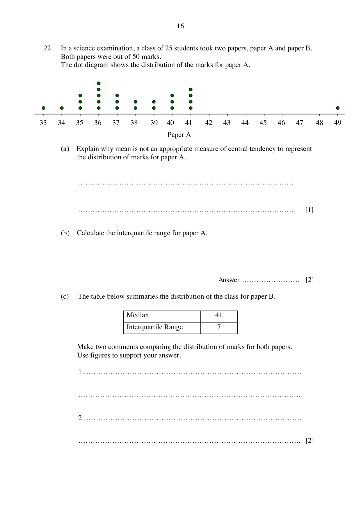

## Question

> **Marks:** 5
> **Page:** 16

In a science examination, a class of 25 students took two papers, paper A and paper B.
Both papers were out of 50 marks.
The dot diagram shows the distribution of the marks for paper A. The axis is marked from 33 to 49.

(a) Explain why mean is not an appropriate measure of central tendency to represent the distribution of marks for paper A. [1]

(b) Calculate the interquartile range for paper A. [2]

(c) The table below summaries the distribution of the class for paper B.

| Median | 41 |
| --- | --- |
| Interquartile Range | 7 |

Make two comments comparing the distribution of marks for both papers.
Use figures to support your answer. [2]
