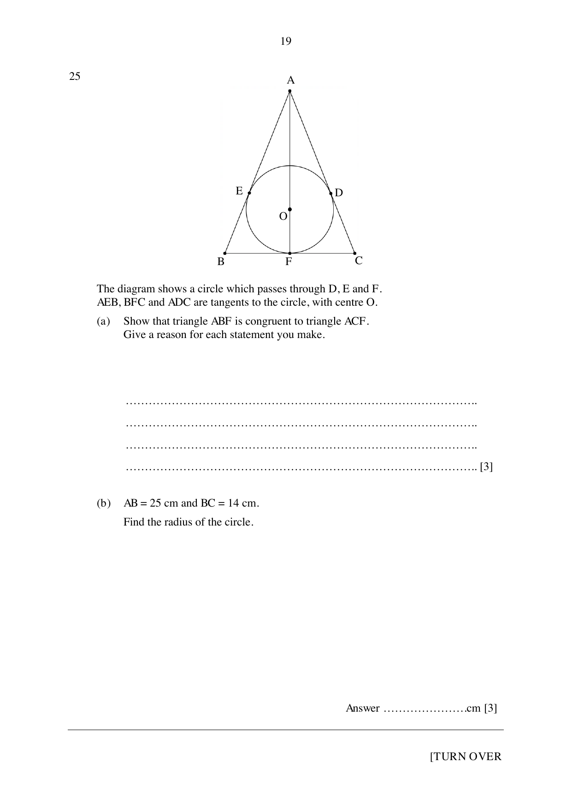

## Question

> **Marks:** 6
> **Page:** 19

The diagram shows a circle which passes through $D$, $E$ and $F$.
$AEB$, $BFC$ and $ADC$ are tangents to the circle, with centre $O$.

(a) Show that triangle $ABF$ is congruent to triangle $ACF$.
Give a reason for each statement you make. [3]

(b) $AB = 25$ cm and $BC = 14$ cm.
Find the radius of the circle. [3]
