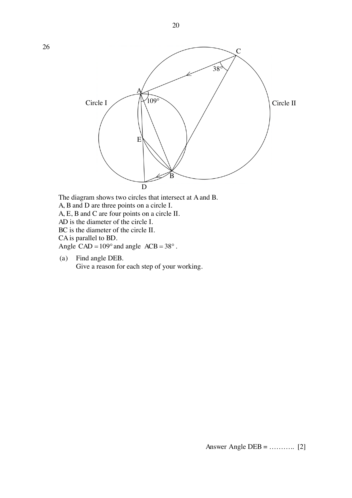

## Question

> **Marks:** 5
> **Page:** 20–21

The diagram shows two circles that intersect at $A$ and $B$.
$A$, $B$ and $D$ are three points on a circle I.
$A$, $E$, $B$ and $C$ are four points on a circle II.
$AD$ is the diameter of the circle I.
$BC$ is the diameter of the circle II.
$CA$ is parallel to $BD$.
Angle $CAD = 109^{\circ}$ and angle $ACB = 38^{\circ}$.

(a) Find angle $DEB$.
Give a reason for each step of your working. [2]

(b) Show that $E$ is the centre of circle I.
Give a reason for each step of your working. [3]
