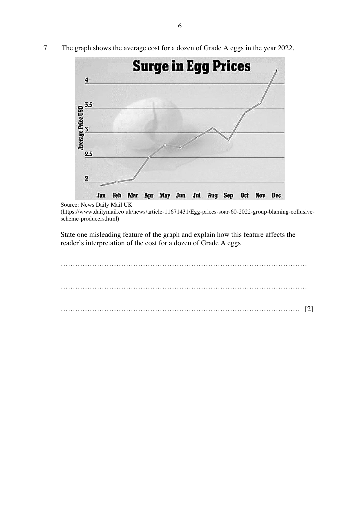

## Question

> **Marks:** 2
> **Page:** 6

The graph shows the average cost for a dozen of Grade A eggs in the year 2022.

Source: News Daily Mail UK.

State one misleading feature of the graph and explain how this feature affects the reader's interpretation of the cost for a dozen of Grade A eggs.
