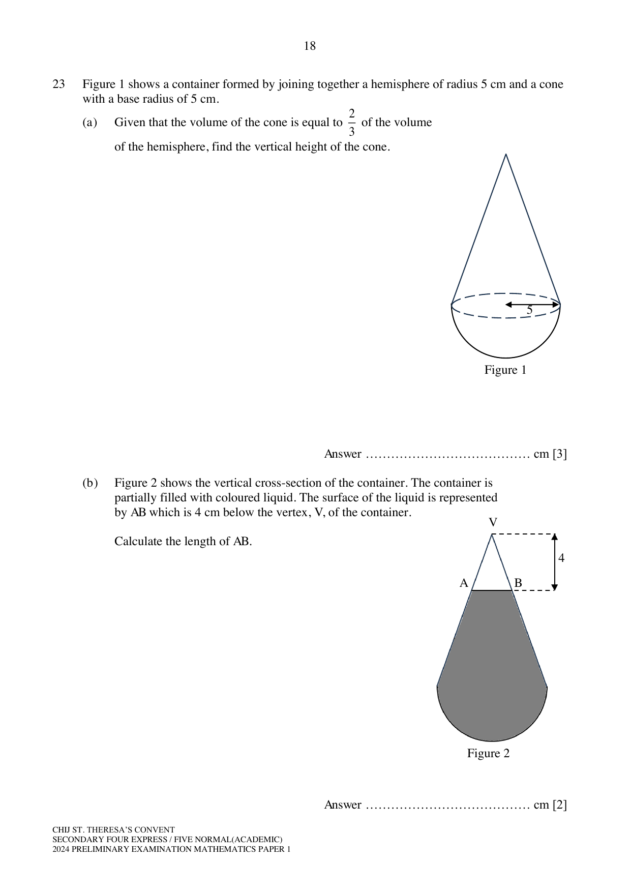

## Question

> **Marks:** 8
> **Page:** 18–19

Figure 1 shows a container formed by joining together a hemisphere of radius 5 cm and a cone with a base radius of 5 cm.

(a) Given that the volume of the cone is equal to $\dfrac{2}{3}$ of the volume of the hemisphere, find the vertical height of the cone. [3]

(b) Figure 2 shows the vertical cross-section of the container. The container is partially filled with coloured liquid. The surface of the liquid is represented by $AB$ which is 4 cm below the vertex, $V$, of the container. Calculate the length of $AB$. [2]

(c) This container is geometrically similar to a larger container. Given that the volume of the larger container is $\dfrac{7}{2}$ of the volume of the container in Figure 1, find the total surface area of the container (in Figure 1) as a percentage of the total surface area of the larger container. [3]

## Answer Scheme

(a)

$$
\text{Vol of hemisphere}=\frac{1}{2}\left(\frac{4}{3}\pi(5)^{3}\right)=\frac{250\pi}{3}\text{ cm}^{3}
$$

$$
\frac{1}{3}\pi(5)^{2}h=\frac{2}{3}\left(\frac{250\pi}{3}\right)
$$

$$
h=\frac{500\pi}{9}\div\frac{\pi(5)^{2}}{3}=6\frac{2}{3}\text{ cm}
$$

(b) Using similar triangles, with $k$ half of $AB$:

$$
\frac{k}{5}=\frac{4}{6\frac{2}{3}}
$$

$$
k=\frac{4\times 5}{6\frac{2}{3}}=3
$$

$$
AB=3\times 2=6\text{ cm}
$$

(c)

$$
\frac{V_{1}}{V_{2}}=\left(\frac{l_{1}}{l_{2}}\right)^{3}
$$

$$
\frac{V_{1}}{\frac{7}{2}V_{1}}=\left(\frac{l_{1}}{l_{2}}\right)^{3}
$$

$$
\frac{2}{7}=\left(\frac{l_{1}}{l_{2}}\right)^{3}
$$

$$
\frac{l_{1}}{l_{2}}=\sqrt[3]{\frac{2}{7}}=0.658633756
$$

$$
\frac{A_{1}}{A_{2}}=\left(\sqrt[3]{\frac{2}{7}}\right)^{2}=0.433798424
$$

$$
\text{Percentage}=\left(\sqrt[3]{\frac{2}{7}}\right)^{2}\times 100\%\approx 43.4\%\text{ (3 s.f.)}
$$
