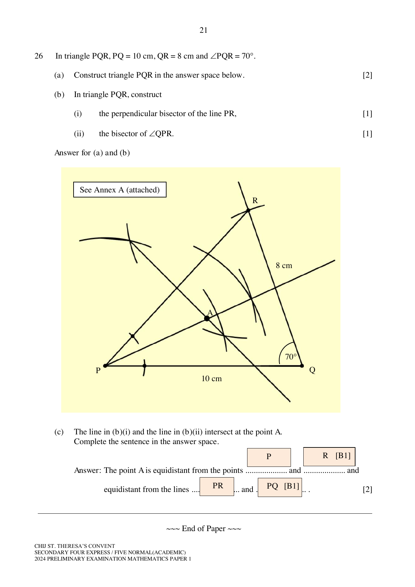

## Question

> **Marks:** 6
> **Page:** 21

In triangle $PQR$, $PQ=10$ cm, $QR=8$ cm and $\angle PQR=70^{\circ}$.

(a) Construct triangle $PQR$ in the answer space below. [2]

(b) In triangle $PQR$, construct

(i) the perpendicular bisector of the line $PR$, [1]

(ii) the bisector of $\angle QPR$. [1]

The printed answer space for (a) and (b) is blank.

(c) The line in (b)(i) and the line in (b)(ii) intersect at the point $A$. Complete the sentence in the answer space.

The point $A$ is equidistant from the points .................... and .................... and equidistant from the lines .................... and ........................ . [2]

## Answer Scheme

(a) and (b) The scheme labels the drawing "See Annex A (attached)". The construction drawn on this solutions page is triangle $PQR$ with $PQ=10$ cm, $QR=8$ cm and $\angle PQR=70^{\circ}$, together with the perpendicular bisector of $PR$, the bisector of $\angle QPR$, and their intersection $A$.

(c) The point $A$ is equidistant from the points $P$ and $R$ [B1] and equidistant from the lines $PR$ and $PQ$ [B1].
