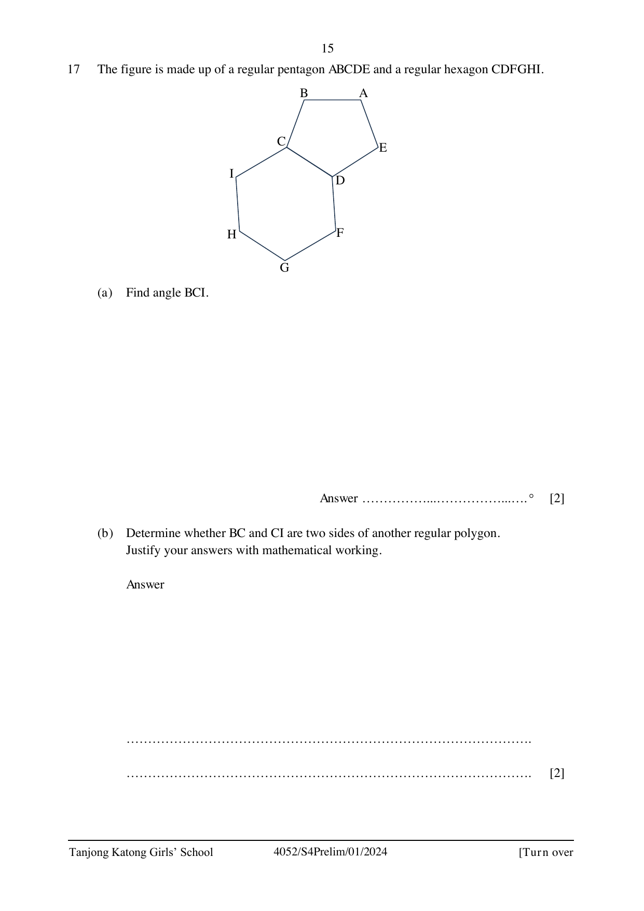

## Question

> **Marks:** 4
> **Page:** 15

The figure is made up of a regular pentagon $ABCDE$ and a regular hexagon $CDFGHI$.

(a) Find angle $BCI$. [2]

(b) Determine whether $BC$ and $CI$ are two sides of another regular polygon.
Justify your answers with mathematical working. [2]
