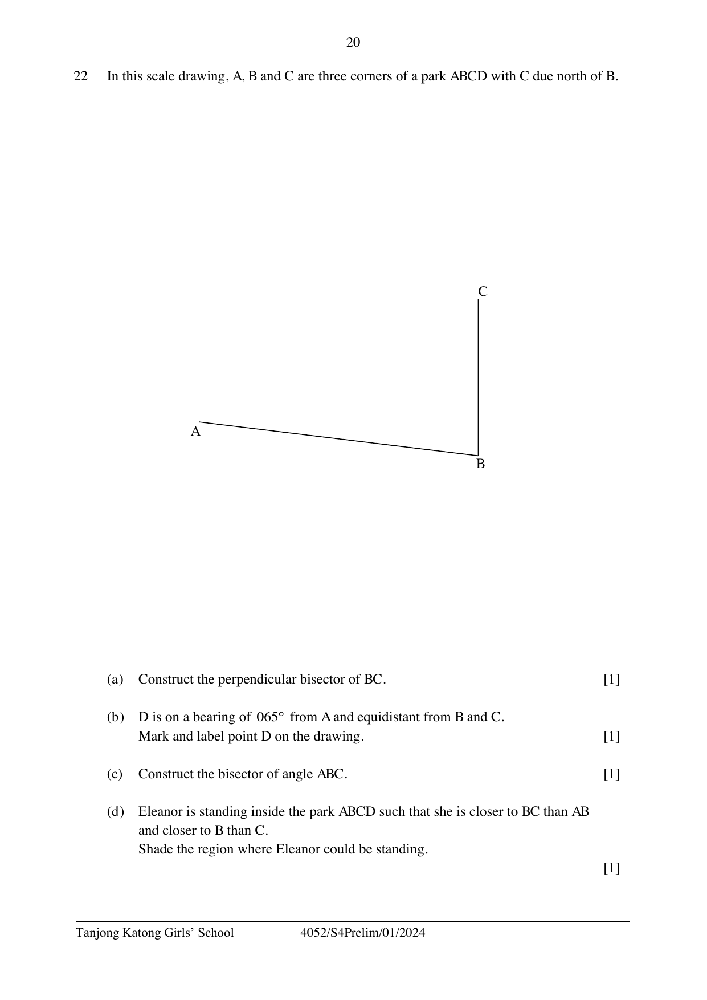

## Question

> **Marks:** 4
> **Page:** 20

In this scale drawing, $A$, $B$ and $C$ are three corners of a park $ABCD$ with $C$ due north of $B$.

(a) Construct the perpendicular bisector of $BC$. [1]

(b) $D$ is on a bearing of $065^{\circ}$ from $A$ and equidistant from $B$ and $C$.
Mark and label point $D$ on the drawing. [1]

(c) Construct the bisector of angle $ABC$. [1]

(d) Eleanor is standing inside the park $ABCD$ such that she is closer to $BC$ than $AB$ and closer to $B$ than $C$.
Shade the region where Eleanor could be standing. [1]
