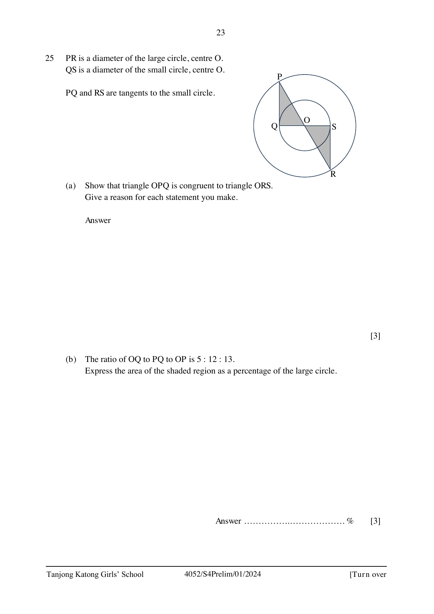

## Question

> **Marks:** 6
> **Page:** 23

$PR$ is a diameter of the large circle, centre $O$.
$QS$ is a diameter of the small circle, centre $O$.

$PQ$ and $RS$ are tangents to the small circle.
Two regions, triangle $OPQ$ and triangle $ORS$, are shaded.

(a) Show that triangle $OPQ$ is congruent to triangle $ORS$.
Give a reason for each statement you make. [3]

(b) The ratio of $OQ$ to $PQ$ to $OP$ is $5 : 12 : 13$.
Express the area of the shaded region as a percentage of the large circle. [3]
