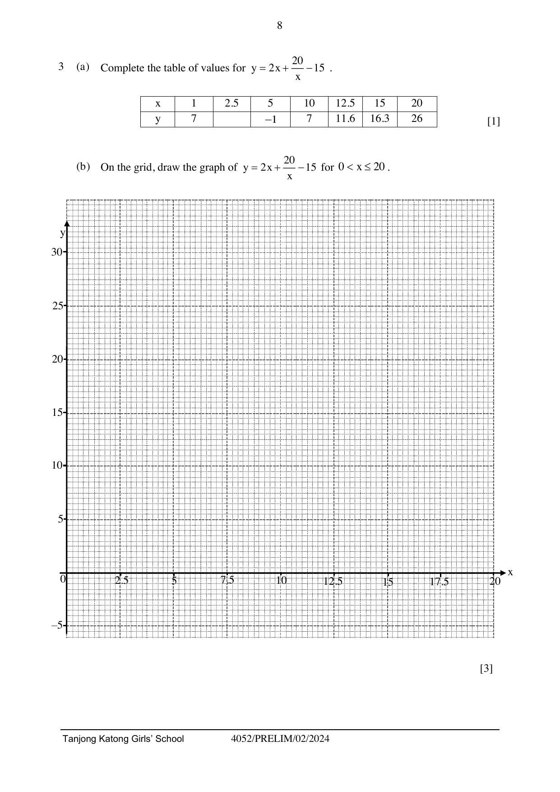

## Question

> **Marks:** 10
> **Page:** 8–9

(a) Complete the table of values for $y = 2x+\dfrac{20}{x}-15$. [1]

| $x$ | 1 | 2.5 | 5 | 10 | 12.5 | 15 | 20 |
| --- | --- | --- | --- | --- | --- | --- | --- |
| $y$ | 7 |  | $-1$ | 7 | 11.6 | 16.3 | 26 |

(b) On the grid, draw the graph of $y = 2x+\dfrac{20}{x}-15$ for $0 < x \le 20$.

The grid has $x$ from 0 to 20, in steps of 2.5, and $y$ from $-5$ to 30. [3]

(c) Using the graph, state the range of values of $x$ for which $2x+\dfrac{20}{x} < 22$. [2]

(d) By drawing a tangent, find the gradient of the curve at the point where $x = 4$. [2]

(e) By drawing a suitable straight line on the grid, find the solutions of the equation $x^{2}-13x+20 = 0$. [2]
