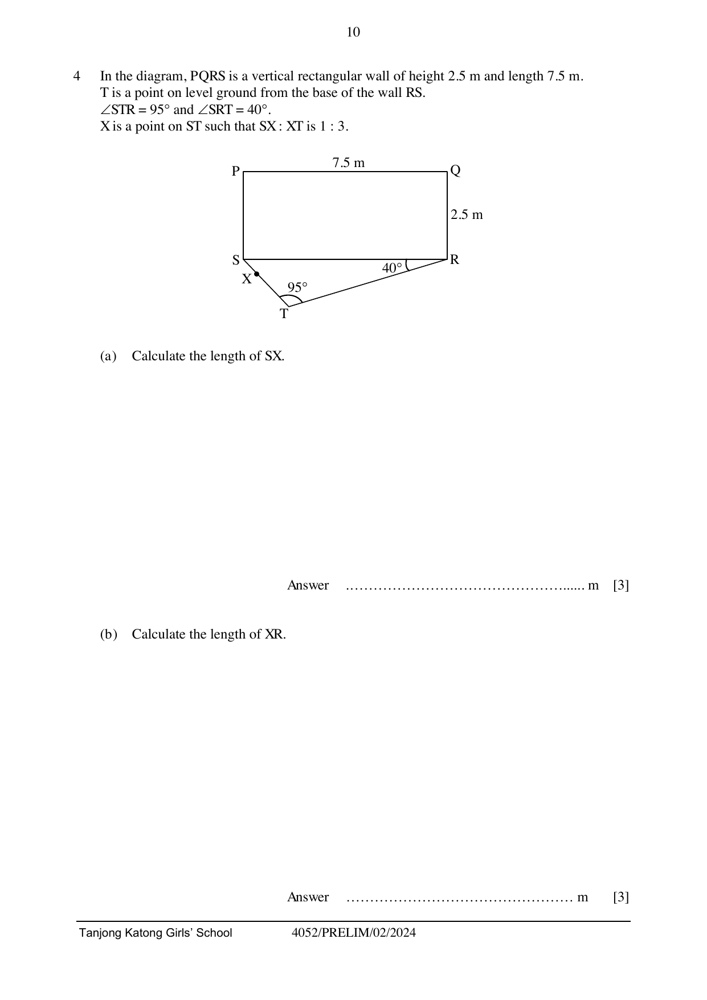

## Question

> **Marks:** 11
> **Page:** 10–11

In the diagram, $PQRS$ is a vertical rectangular wall of height 2.5 m and length 7.5 m.
$T$ is a point on level ground from the base of the wall $RS$.
$\angle STR = 95^{\circ}$ and $\angle SRT = 40^{\circ}$.
$X$ is a point on $ST$ such that $SX : XT$ is $1 : 3$.

(a) Calculate the length of $SX$. [3]

(b) Calculate the length of $XR$. [3]

(c) Calculate the length of $PT$. [1]

(d) A bird sat on the ledge of the wall along $PQ$ such that its angle of elevation $\theta$ from $X$ is the largest. Find $\theta$. [4]
