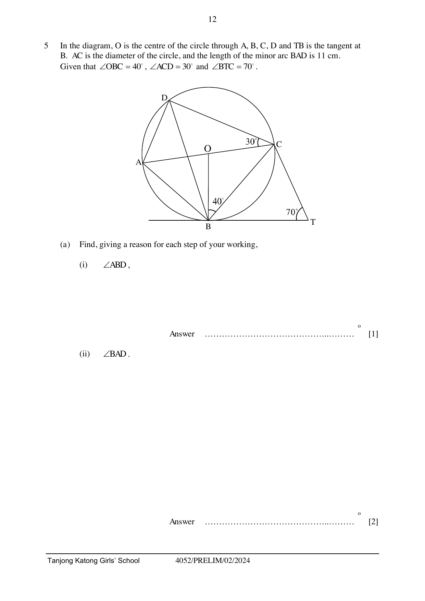

## Question

> **Marks:** 11
> **Page:** 12–13

In the diagram, $O$ is the centre of the circle through $A$, $B$, $C$, $D$ and $TB$ is the tangent at $B$. $AC$ is the diameter of the circle, and the length of the minor arc $BAD$ is 11 cm.
Given that $\angle OBC = 40^{\circ}$, $\angle ACD = 30^{\circ}$ and $\angle BTC = 70^{\circ}$.

(a) Find, giving a reason for each step of your working,

(i) $\angle ABD$, [1]

(ii) $\angle BAD$, [2]

(iii) Taking $\pi = \dfrac{22}{7}$, calculate the radius of the circle. [2]

(b) (i) Show that triangle $BCD$ is similar to triangle $CTB$. Give a reason for each statement you make. [4]

(ii) Hence, express $CT$ in terms of $x$ and $y$ given that $BC = x$ cm and $BD = y$ cm. [2]
