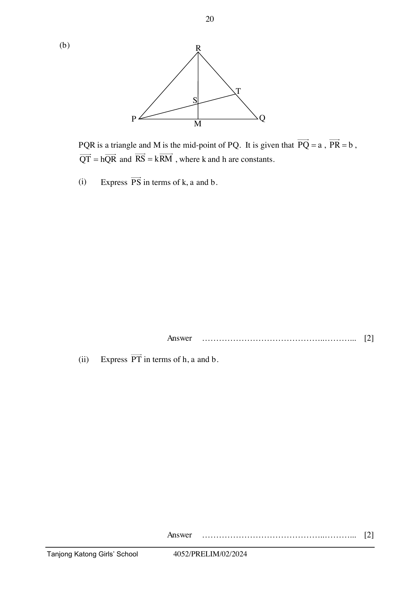

## Question

> **Marks:** 11
> **Page:** 18–21

(a) $\overrightarrow{AB} = \begin{pmatrix} -3 \\ 9 \end{pmatrix}$, $\overrightarrow{BC} = \begin{pmatrix} 2 \\ 5 \end{pmatrix}$, $\overrightarrow{CD} = \begin{pmatrix} d \\ 4 \end{pmatrix}$.

(i) Given that $\overrightarrow{CD}$ is parallel to $\overrightarrow{AB}$, find the value of $d$. [2]

(ii) Find $AC$. [2]

(b) $PQR$ is a triangle and $M$ is the mid-point of $PQ$. It is given that $\overrightarrow{PQ} = \mathbf{a}$, $\overrightarrow{PR} = \mathbf{b}$, $\overrightarrow{QT} = h\overrightarrow{QR}$ and $\overrightarrow{RS} = k\overrightarrow{RM}$, where $k$ and $h$ are constants.

(i) Express $\overrightarrow{PS}$ in terms of $k$, $\mathbf{a}$ and $\mathbf{b}$. [2]

(ii) Express $\overrightarrow{PT}$ in terms of $h$, $\mathbf{a}$ and $\mathbf{b}$. [2]

(iii) Hence show that $hk+2 = 2(h+k)$ if $P$, $S$ and $T$ are collinear. [1]

(iv) Given that $h = \dfrac{1}{3}$ and $k = \dfrac{4}{5}$, find the ratio of $PS : ST$. [2]
