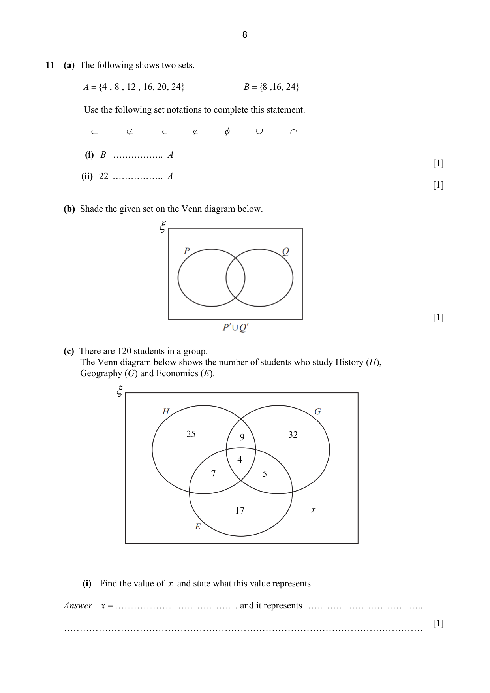
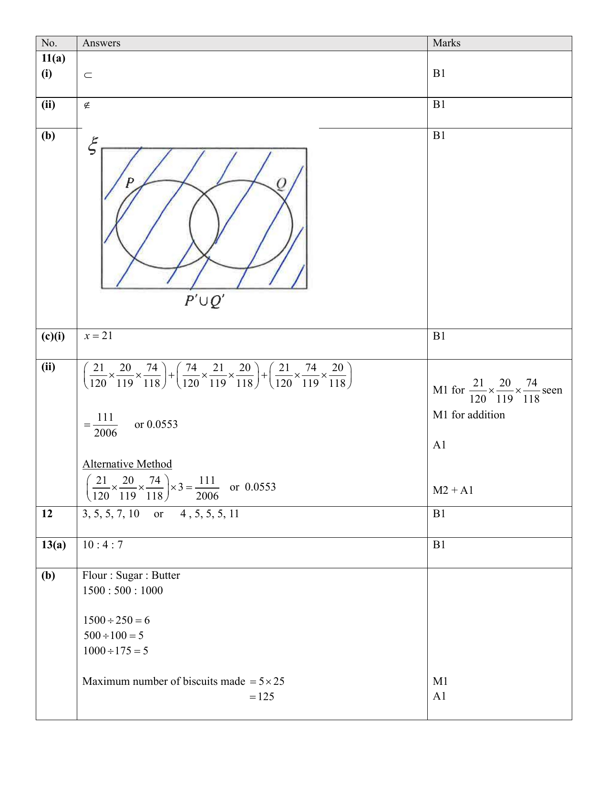

## Question

> **Marks:** 6
> **Page:** 8–9

(a) The following shows two sets.

$A = \{4, 8, 12, 16, 20, 24\}$ $\qquad$ $B = \{8, 16, 24\}$

Use the following set notations to complete this statement.

$\subset \qquad \not\subset \qquad \in \qquad \notin \qquad \varnothing \qquad \cup \qquad \cap$

(i) $B \ldots\ldots A$ [1]

(ii) $22 \ldots\ldots A$ [1]

(b) Shade the given set on the Venn diagram below. The set printed under the diagram is $P' \cup Q'$. [1]

(c) There are 120 students in a group.
The Venn diagram below shows the number of students who study History ($H$), Geography ($G$) and Economics ($E$).

Regions: $H$ only $25$; $H \cap G$ only $9$; $G$ only $32$; $H \cap E$ only $7$; $H \cap G \cap E$ is $4$; $G \cap E$ only $5$; $E$ only $17$; outside the three circles, $x$.

(i) Find the value of $x$ and state what this value represents. [1]

(ii) Two of the students who study Economics are chosen at random.

Find, as a fraction in its simplest form, the probability that one of these students also studies Geography but not History and the other student also studies History but not Geography. [2]

## Answer Scheme

(a) (i) $\subset$. B1

(ii) $\notin$. B1

(b) The region outside both circles, inside the rectangle, is shaded (everything except $P \cup Q$). B1

(c) (i) $x = 21$. B1

The scheme does not state what $x$ represents.

(ii)

$$
\left(\frac{21}{120} \times \frac{20}{119} \times \frac{74}{118}\right) + \left(\frac{74}{120} \times \frac{21}{119} \times \frac{20}{118}\right) + \left(\frac{21}{120} \times \frac{74}{119} \times \frac{20}{118}\right)
$$

$$
= \frac{111}{2006} \text{ or } 0.0553
$$

M1 for $\dfrac{21}{120} \times \dfrac{20}{119} \times \dfrac{74}{118}$ seen. M1 for addition. A1

Alternative method:

$$
\left(\frac{21}{120} \times \frac{20}{119} \times \frac{74}{118}\right) \times 3 = \frac{111}{2006} \text{ or } 0.0553
$$

M2 + A1
