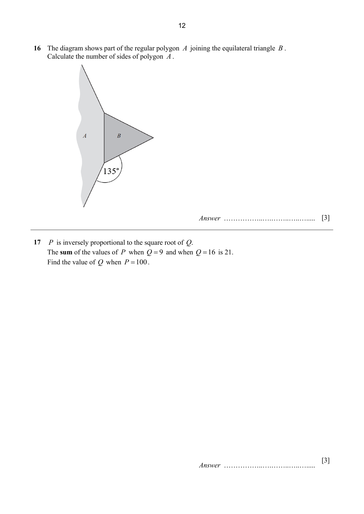

## Question

> **Marks:** 3
> **Page:** 12

The diagram shows part of the regular polygon $A$ joining the equilateral triangle $B$.
Calculate the number of sides of polygon $A$.

An angle of $135^{\circ}$ is marked at the join, between a side of the polygon and a side of the triangle.

## Answer Scheme

Interior angle of polygon A $= 360^{\circ}-135^{\circ}-60^{\circ} = 165^{\circ}$. B1

Let $n$ be the number of sides of polygon A.

$$
\frac{(n-2) \times 180}{n} = 165 \quad \text{M1}
$$

$$
180n-360 = 165n
$$

$$
n = \frac{360}{15} = 24 \quad \text{A1}
$$
