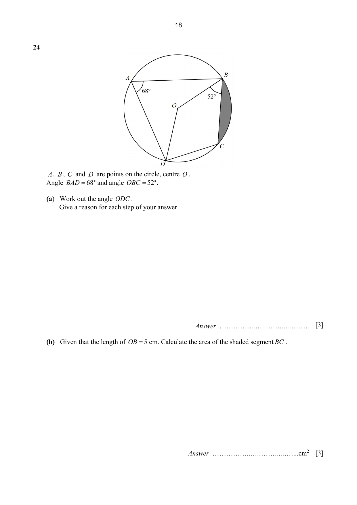

## Question

> **Marks:** 6
> **Page:** 18

$A$, $B$, $C$ and $D$ are points on the circle, centre $O$.
Angle $BAD = 68^{\circ}$ and angle $OBC = 52^{\circ}$.
The segment $BC$ is shaded.

(a) Work out the angle $ODC$.
Give a reason for each step of your answer. [3]

(b) Given that the length of $OB = 5$ cm. Calculate the area of the shaded segment $BC$. [3]

## Answer Scheme

(a) $\angle DOB = 68 \times 2 = 136^{\circ}$ (angle at centre = twice angle on circumference). B1 for correct reasoning.

$\angle BCD = 180-68 = 112^{\circ}$ (angles in opposite segment). B1 for correct reasoning.

$\angle ODC = 360-52-136-112 = 60^{\circ}$ (sum of angles in a quadrilateral is $360^{\circ}$). B1

(b) Area of the shaded segment $=$ area of sector $OCB$ $-$ area of triangle $OCB$

$$
= \frac{76}{360} \times \pi \times 5^{2} - \frac{1}{2} \times 5^{2} \times \sin 76^{\circ} \quad \text{M1, M1}
$$

$$
= 4.451932 = 4.45 \text{ cm}^{2} \quad \text{A1}
$$
