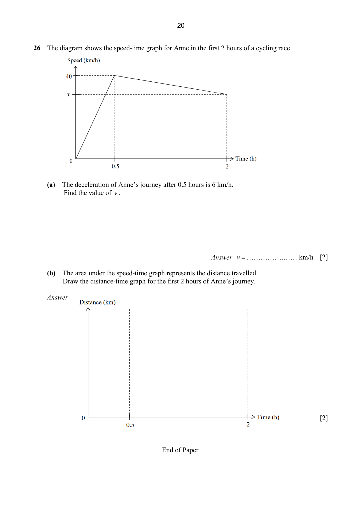
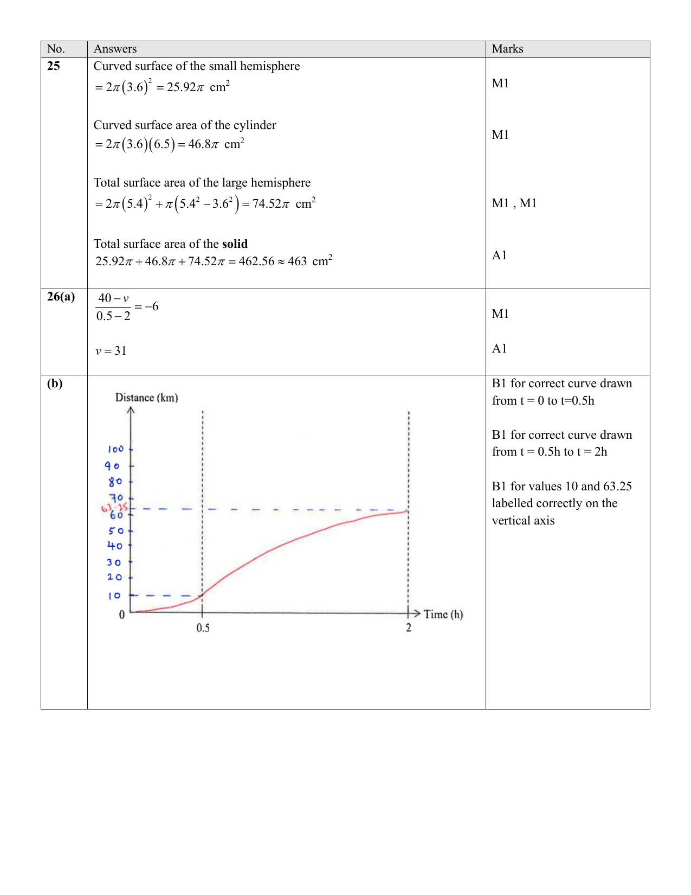

## Question

> **Marks:** 4
> **Page:** 20

The diagram shows the speed-time graph for Anne in the first 2 hours of a cycling race.
Speed rises from 0 to 40 km/h in the first 0.5 h, then falls in a straight line to $v$ km/h at 2 h. A horizontal dashed line marks speed $v$.

(a) The deceleration of Anne's journey after 0.5 hours is 6 km/h.
Find the value of $v$. [2]

(b) The area under the speed-time graph represents the distance travelled.
Draw the distance-time graph for the first 2 hours of Anne's journey.
Blank axes are provided, with time marks at 0, 0.5 and 2 hours. [2]

## Answer Scheme

(a)

$$
\frac{40-v}{0.5-2} = -6 \quad \text{M1}
$$

$$
v = 31 \quad \text{A1}
$$

(b) A curve from the origin to about 10 km at $t = 0.5$ h, then a shallower curve to 63.25 km at $t = 2$ h. The scheme labels 10 and 63.25 on the vertical axis.

B1 for the correct curve from $t = 0$ to $t = 0.5$ h.

B1 for the correct curve from $t = 0.5$ h to $t = 2$ h.

B1 for the values 10 and 63.25 labelled correctly on the vertical axis.

The question paper prints [2] for this part; the scheme shows three B marks.

