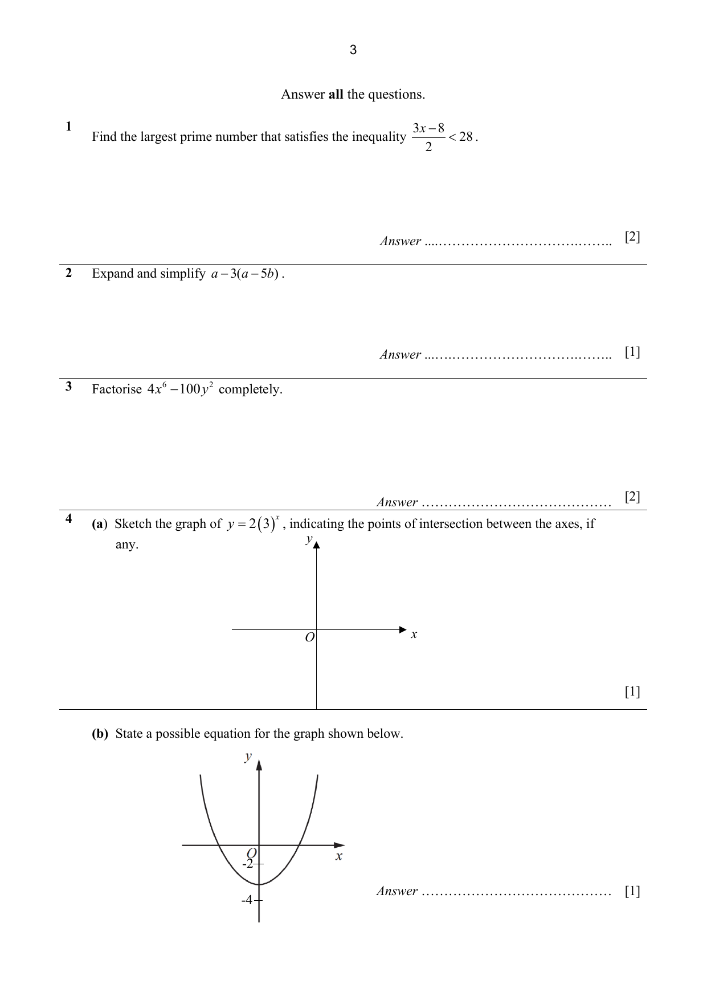
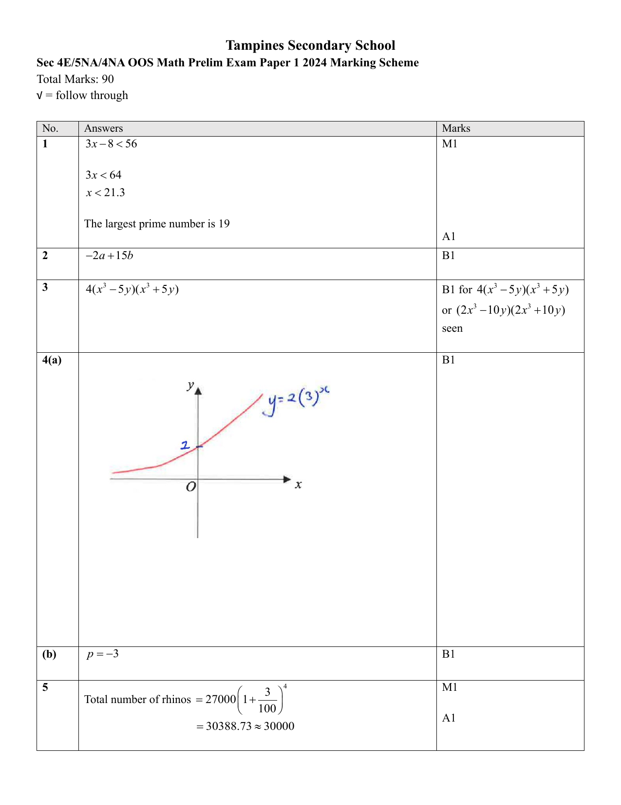

## Question

> **Marks:** 2
> **Page:** 3

(a) Sketch the graph of $y = 2(3)^{x}$, indicating the points of intersection between the axes, if any. Axes are provided. [1]

(b) State a possible equation for the graph shown below. [1]

## Answer Scheme

(a) Increasing curve of $y = 2(3)^{x}$, crossing the $y$-axis at 2, with a horizontal asymptote along the negative $x$-axis. B1

(b) $p = -3$. B1
