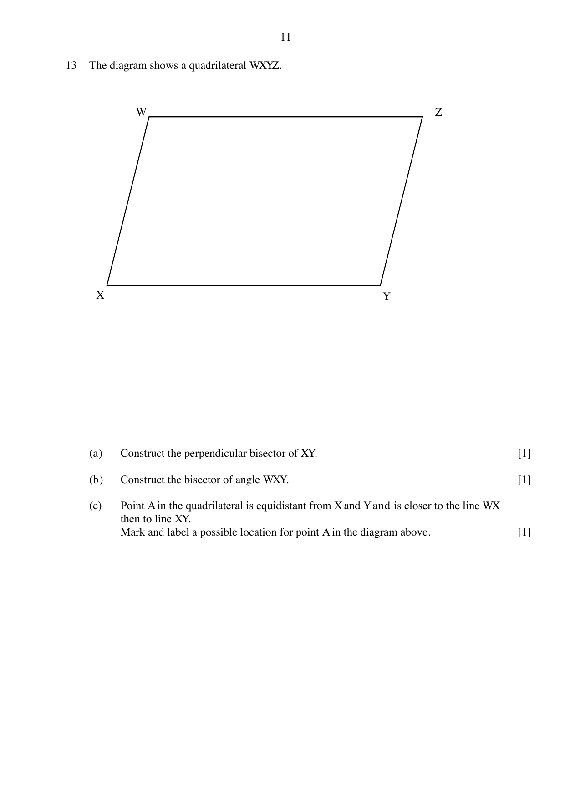
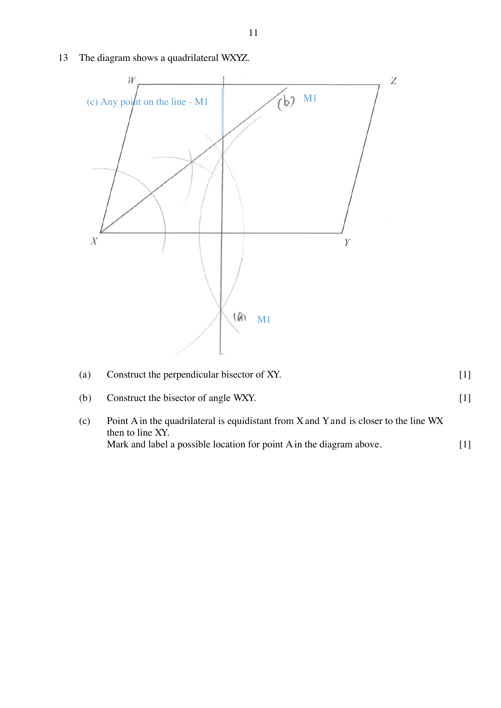

## Question

> **Marks:** 3
> **Page:** 11

The diagram shows a quadrilateral $WXYZ$.

(a) Construct the perpendicular bisector of $XY$. [1]

(b) Construct the bisector of angle $WXY$. [1]

(c) Point $A$ in the quadrilateral is equidistant from $X$ and $Y$ and is closer to the line $WX$ then to line $XY$. Mark and label a possible location for point $A$ in the diagram above. [1]

## Answer Scheme

(a) Perpendicular bisector of $XY$ [M1].

(b) Bisector of angle $WXY$ [M1].

(c) Any point on the line (the perpendicular bisector, on the side closer to $WX$) [M1].
