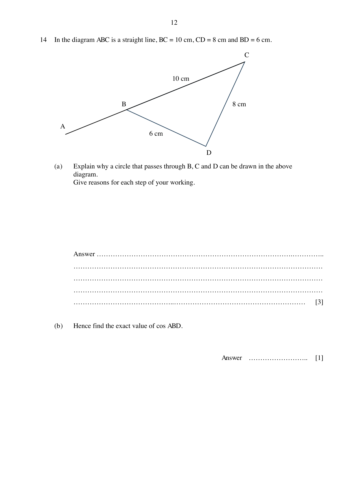

## Question

> **Marks:** 4
> **Page:** 12

In the diagram $ABC$ is a straight line, $BC = 10$ cm, $CD = 8$ cm and $BD = 6$ cm.

(a) Explain why a circle that passes through $B$, $C$ and $D$ can be drawn in the above diagram. Give reasons for each step of your working. [3]

(b) Hence find the exact value of $\cos ABD$. [1]

## Answer Scheme

(a) $BC^{2} = 100$

$BD^{2}+CD^{2} = 64+36 = 100$

$BD^{2}+CD^{2} = BC^{2}$ [M1]

By the converse of Pythagoras' theorem, angle $BDC$ is $90^{\circ}$ [M1].

A circle that passes through $B$, $C$ and $D$ can be drawn (angle in semi circle) [A1].

(b) $-\dfrac{3}{5}$ [B1]
