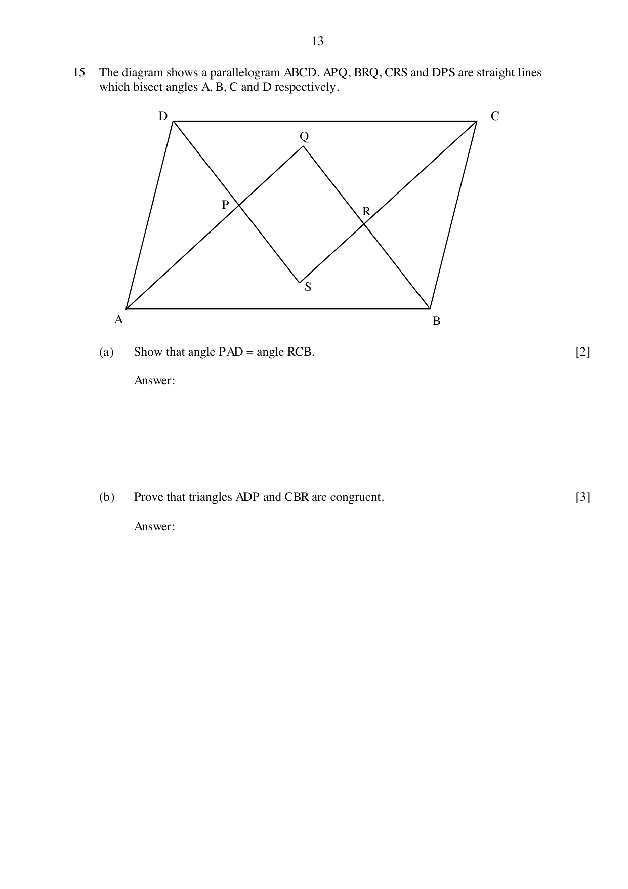

## Question

> **Marks:** 5
> **Page:** 13

The diagram shows a parallelogram $ABCD$. $APQ$, $BRQ$, $CRS$ and $DPS$ are straight lines which bisect angles $A$, $B$, $C$ and $D$ respectively.

(a) Show that angle $PAD =$ angle $RCB$. [2]

(b) Prove that triangles $ADP$ and $CBR$ are congruent. [3]

## Answer Scheme

(a) $\angle DAB = \angle BCD$ (opposite angle of parallelogram) [M1]

$\angle DAP = \angle PAB = \angle BCR = \angle RCD$ (bisect angle)

$\therefore \angle PAD = \angle RCB$ [A1]

(b) In triangle $ADP$ and triangle $CBR$,

$\angle PAD = \angle RCB$ (from (a))

$AD = CB$ opposite side of parallelogram [M1]

$\angle ADP = \angle CBR$ [M1]

$\therefore$ triangle $ADP$ and triangle $CBR$ (ASA) [A1]
