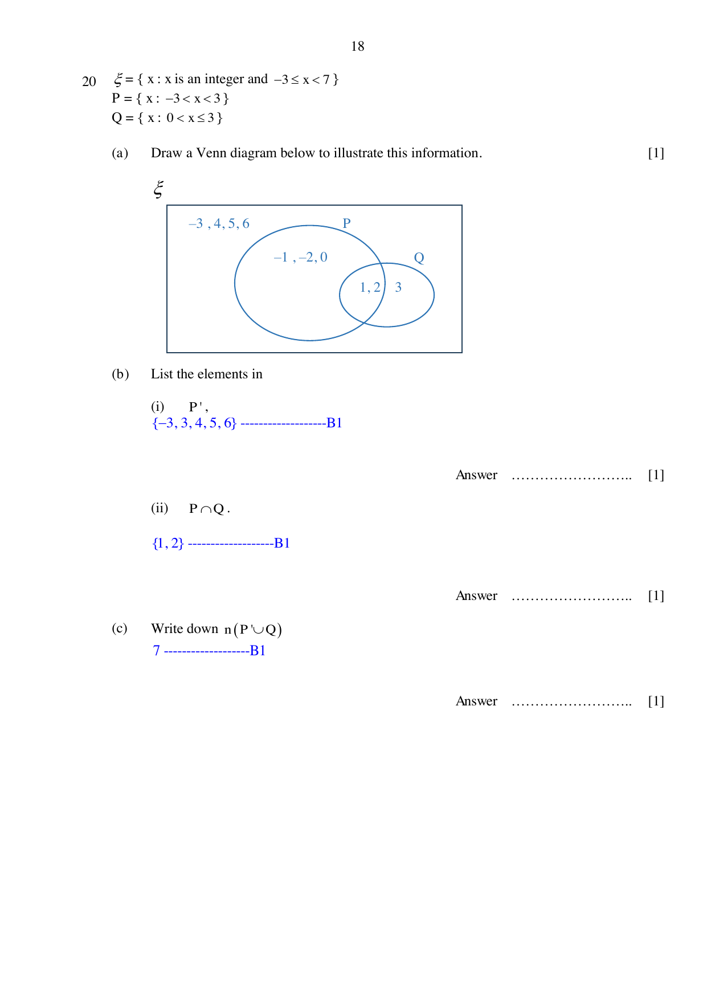

## Question

> **Marks:** 4
> **Page:** 18

$\xi = \{x : x\text{ is an integer and }-3 \le x < 7\}$

$P = \{x : -3 < x < 3\}$

$Q = \{x : 0 < x \le 3\}$

(a) Draw a Venn diagram below to illustrate this information. [1]

(b) List the elements in

(i) $P'$, [1]

(ii) $P \cap Q$. [1]

(c) Write down $n(P' \cup Q)$ [1]

## Answer Scheme

(a) Outside both sets: $-3$, $4$, $5$, $6$. In $P$ only: $-1$, $-2$, $0$. In $P \cap Q$: $1$, $2$. In $Q$ only: $3$. [B1]

(b) (i) $P' = \{-3, 3, 4, 5, 6\}$ [B1]

(ii) $P \cap Q = \{1, 2\}$ [B1]

(c) $n(P' \cup Q) = 7$ [B1]
