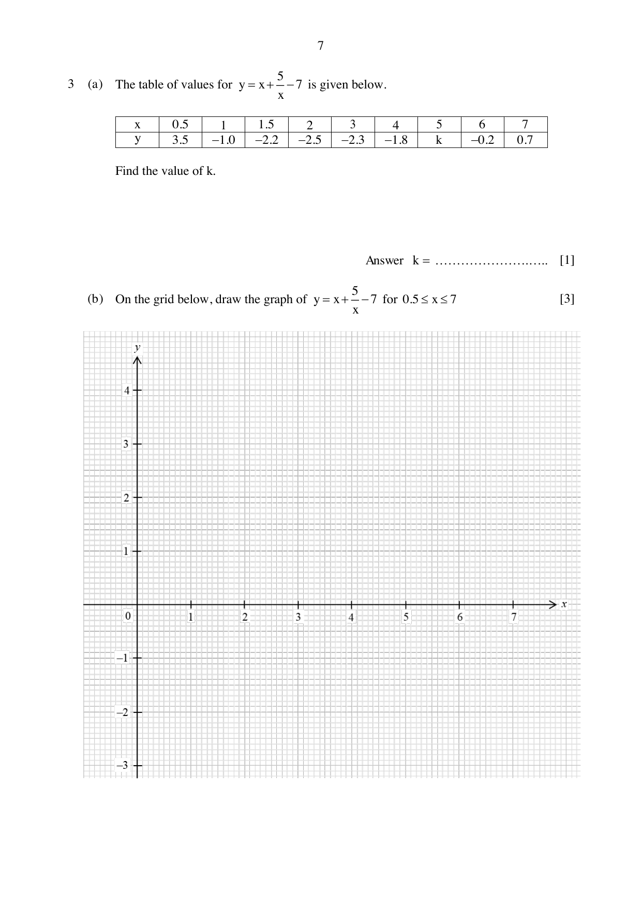

## Question

> **Marks:** 12
> **Page:** 7–8

(a) The table of values for $y = x+\dfrac{5}{x}-7$ is given below. Find the value of $k$. [1]

| $x$ | 0.5 | 1 | 1.5 | 2 | 3 | 4 | 5 | 6 | 7 |
| --- | --- | --- | --- | --- | --- | --- | --- | --- | --- |
| $y$ | 3.5 | $-1.0$ | $-2.2$ | $-2.5$ | $-2.3$ | $-1.8$ | $k$ | $-0.2$ | 0.7 |

(b) On the grid below, draw the graph of $y = x+\dfrac{5}{x}-7$ for $0.5\le x\le 7$. [3]

(c) Use your graph to find the solutions to $x+\dfrac{5}{x} = 5$ in the range $0.5\le x\le 7$. [3]

(d) By drawing a tangent, find the gradient of the curve at $(4, -1.8)$. [2]

(e) The solutions of $Px^{2}+Qx+5 = 0$ are the same as the $x$-coordinates of the intersections between the graph $y = x+\dfrac{5}{x}-7$ and the line $y = -x+3$. Find the values of $P$ and $Q$. [3]

## Answer Scheme

(a) $k = 5+\dfrac{5}{5}-7 = -1$. [B1]

(b) 0 to 4 points plotted correctly [G1]. All points plotted correctly [G1]. Smooth curve [G1].

(c) Draw $y = -2$. [M1]

$x = 1.4\pm 0.1$ and $x = 3.6\pm 0.1$. [A1, A1]

(d) Tangent at $(4, -1.8)$. Estimated gradient $0.688\pm 0.1$. [M1, A1]

(e) $x+\dfrac{5}{x}-7 = -x+3$ gives $2x^{2}-10x+5 = 0$. [M1]

$P = 2$ and $Q = -10$. [A1, A1]
