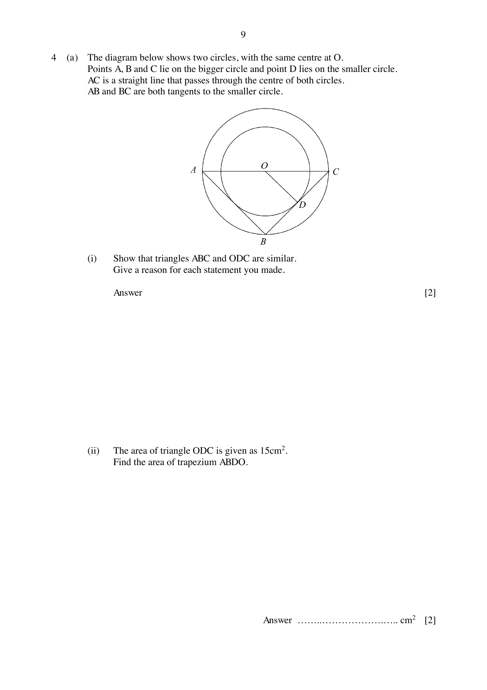
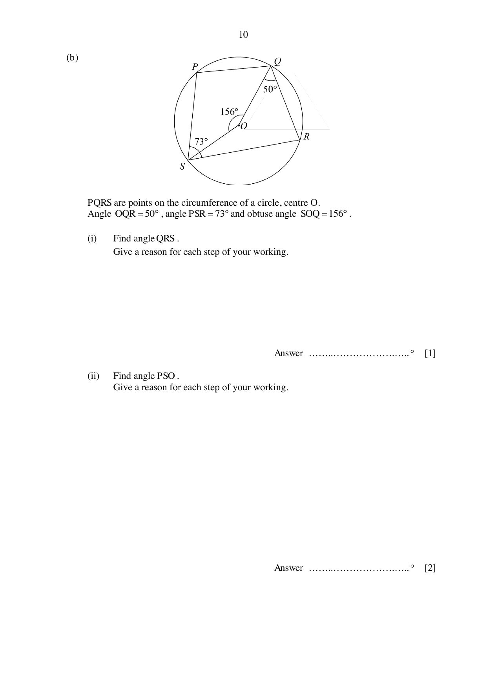

## Question

> **Marks:** 11
> **Page:** 9–11

(a) The diagram below shows two circles, with the same centre at $O$. Points $A$, $B$ and $C$ lie on the bigger circle and point $D$ lies on the smaller circle. $AC$ is a straight line that passes through the centre of both circles. $AB$ and $BC$ are both tangents to the smaller circle.

(i) Show that triangles $ABC$ and $ODC$ are similar. Give a reason for each statement you made. [2]

(ii) The area of triangle $ODC$ is given as $15\text{ cm}^{2}$. Find the area of trapezium $ABDO$. [2]

(b) $P$, $Q$, $R$ and $S$ are points on the circumference of a circle, centre $O$. Angle $OQR = 50^{\circ}$, angle $PSR = 73^{\circ}$ and obtuse angle $SOQ = 156^{\circ}$.

(i) Find angle $QRS$. Give a reason for each step of your working. [1]

(ii) Find angle $PSO$. Give a reason for each step of your working. [2]

(iii) Find angle $PQO$. Give a reason for each step of your working. [2]

(iv) Explain whether line $PQ$ is parallel to line $SR$. Support your answer with workings. [2]

## Answer Scheme

(a) (i) Angle $ACB =$ angle $OCD$ (common angle). Angle $ABC = 90^{\circ}$ (angle in a semicircle) and angle $ODC = 90^{\circ}$ (tangent perpendicular to radius). Hence the triangles are similar (AA). [B1, B1]

Minus 1 mark if the test is not stated.

(ii) $\dfrac{\text{area }ABC}{15} = \left(\dfrac{2}{1}\right)^{2}$, so area $ABC = 60$. Trapezium $ABDO = 60-15 = 45\text{ cm}^{2}$. [M1, A1]

(b) (i) Angle $QRS = \dfrac{156^{\circ}}{2} = 78^{\circ}$ (angle at the centre is twice the angle at the circumference). [B1]

(ii) Angle $SRO = 78^{\circ}-50^{\circ} = 28^{\circ}$ (isosceles triangle). Angle $PSO = 73^{\circ}-28^{\circ} = 45^{\circ}$. [M1, A1]

(iii) Angle $PQR = 180^{\circ}-73^{\circ} = 107^{\circ}$ (opposite segment). Angle $PQO = 107^{\circ}-50^{\circ} = 57^{\circ}$. [M1, A1]

(iv) $107^{\circ}+78^{\circ} = 185^{\circ}\neq 180^{\circ}$, so $PQ$ is not parallel to $SR$. [M1, A1]

A maximum of 1 mark is deducted from Q4(b) if no reasons are given.
