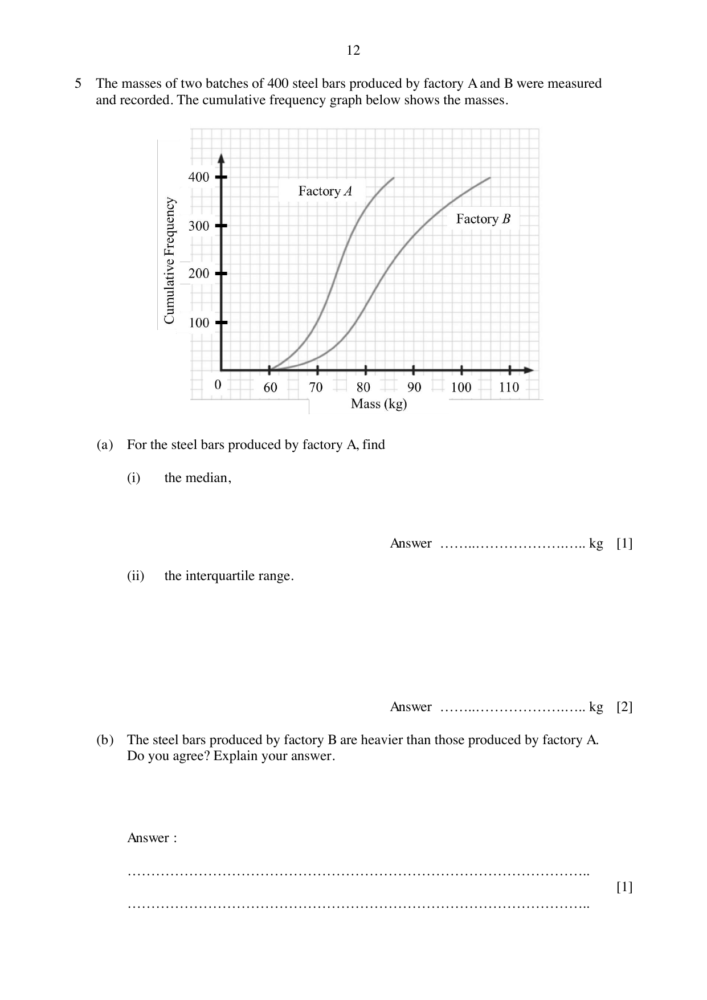

## Question

> **Marks:** 9
> **Page:** 12–13

The masses of two batches of 400 steel bars produced by factory A and B were measured and recorded. The cumulative frequency graph below shows the masses.

(a) For the steel bars produced by factory A, find

(i) the median, [1]

(ii) the interquartile range. [2]

(b) The steel bars produced by factory B are heavier than those produced by factory A. Do you agree? Explain your answer. [1]

(c) Which factory is more consistent in the production of steel bars? Support your answer with workings. [2]

(d) One steel bar is chosen at random from factory A and another steel bar is chosen at random from factory B. Find, as a fraction in its simplest form, the probability that both steel bars chosen are more than $80$ kg. [3]

## Answer Scheme

(a) (i) Median $= 74$ kg. [B1]

(ii) $Q_{3} = 78$ kg, $Q_{1} = 70$ kg. Interquartile range $= 8$ kg. [M1, A1]

(b) Yes. The median of factory B is larger than the median of factory A. [B1]

(c) IQR of factory B $= 92-78 = 14$ kg. Factory A is more consistent because its IQR is smaller. [M1, A1]

(d) Factory A: $60$ or $70$ of $400$. Factory B: $260$ or $270$ of $400$.

Using $60$ and $260$: $\dfrac{60}{400}\times\dfrac{260}{400} = \dfrac{39}{400}$. [M1, M1, A1]

Also accept $\dfrac{81}{800}$, $\dfrac{91}{800}$ and $\dfrac{189}{1600}$.
