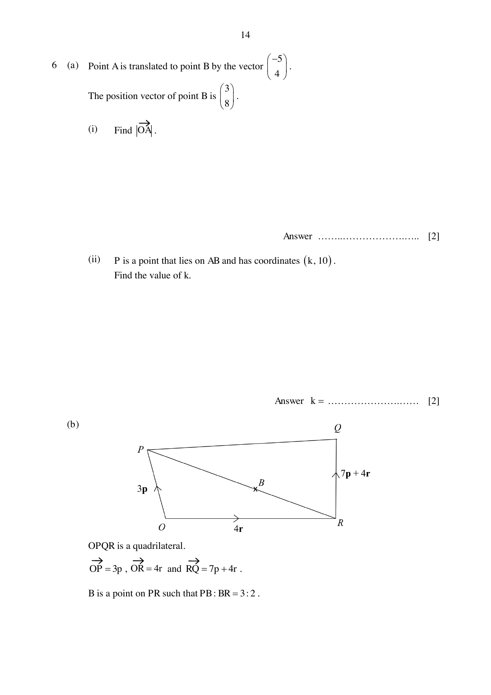

## Question

> **Marks:** 10
> **Page:** 14–15

(a) Point $A$ is translated to point $B$ by the vector $\begin{pmatrix} -5 \\ 4 \end{pmatrix}$. The position vector of point $B$ is $\begin{pmatrix} 3 \\ 8 \end{pmatrix}$.

(i) Find $OA$. [2]

(ii) $P$ is a point that lies on $AB$ and has coordinates $(k, 10)$. Find the value of $k$. [2]

(b) $OPQR$ is a quadrilateral. $\overrightarrow{OP} = 3\mathbf{p}$, $\overrightarrow{OR} = 4\mathbf{r}$ and $\overrightarrow{RQ} = 7\mathbf{p}+4\mathbf{r}$. $B$ is a point on $PR$ such that $PB:BR = 3:2$.

Write each of the following in terms of $\mathbf{p}$ and $\mathbf{r}$. Give your answer in its simplest form.

(i) $\overrightarrow{OQ}$ [1]

(ii) $\overrightarrow{PQ}$ [1]

(iii) $\overrightarrow{OB}$ [3]

(c) Explain why points $O$, $B$ and $Q$ are not collinear. [1]

## Answer Scheme

(a) (i) $\overrightarrow{OA} = \begin{pmatrix} 3 \\ 8 \end{pmatrix}-\begin{pmatrix} -5 \\ 4 \end{pmatrix} = \begin{pmatrix} 8 \\ 4 \end{pmatrix}$. [M1]

$OA = \sqrt{64+16} = 8.94$ (3 s.f.). [A1]

(ii) $\dfrac{10-4}{k-8} = \dfrac{10-8}{k-3}$, so $k = \dfrac{1}{2}$. [M1, A1]

(b) (i) $\overrightarrow{OQ} = 7\mathbf{p}+8\mathbf{r}$. [B1]

(ii) $\overrightarrow{PQ} = 4\mathbf{p}+8\mathbf{r}$. [B1]

(iii) $\overrightarrow{PR} = -3\mathbf{p}+4\mathbf{r}$. $\overrightarrow{PB} = \dfrac{3}{5}\overrightarrow{PR}$. [M1]

$\overrightarrow{OB} = \dfrac{6}{5}\mathbf{p}+\dfrac{12}{5}\mathbf{r}$. [M1, A1]

(c) $\overrightarrow{OB}$ is not a scalar multiple of $\overrightarrow{OQ} = 7\mathbf{p}+8\mathbf{r}$, so the points are not collinear. [B1]
