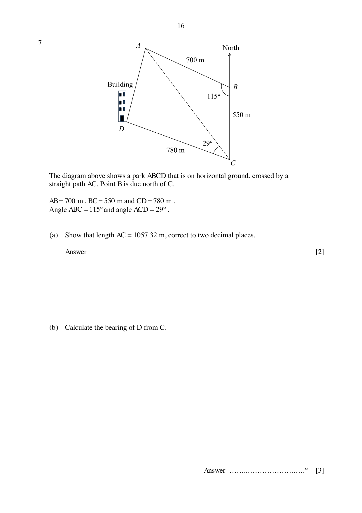

## Question

> **Marks:** 9
> **Page:** 16–17

The diagram shows a park $ABCD$ that is on horizontal ground, crossed by a straight path $AC$. Point $B$ is due north of $C$. $AB = 700$ m, $BC = 550$ m and $CD = 780$ m. Angle $ABC = 115^{\circ}$ and angle $ACD = 29^{\circ}$.

(a) Show that length $AC = 1057.32$ m, correct to two decimal places. [2]

(b) Calculate the bearing of $D$ from $C$. [3]

(c) Find the total area of the park $ABCD$. Correct your answer to the nearest whole number. [2]

(d) A vertical building is located at point $D$. The angle of elevation of the top of the building from point $C$ is $10.9^{\circ}$. Find the height of the building. [2]

## Answer Scheme

(a) $AC^{2} = 700^{2}+550^{2}-2(700)(550)\cos 115^{\circ} = 1117916.062$. $AC = 1057.32$ m, shown. [M1, A1]

(b) $\dfrac{\sin\angle BCA}{700} = \dfrac{\sin 115^{\circ}}{1057.315}$, so $\angle BCA = 36.871^{\circ}$. [M1, M1]

Bearing of $D$ from $C = 360^{\circ}-29^{\circ}-36.871^{\circ} = 294.1^{\circ}$. [A1]

(c) Area $= \dfrac{1}{2}(700)(550)\sin 115^{\circ}+\dfrac{1}{2}(780)(1057.32)\sin 29^{\circ} = 374378\text{ m}^{2}$, or $374377$. [M1, A1]

(d) $\tan 10.9^{\circ} = \dfrac{\text{height}}{780}$, so the height is $150$ m (3 s.f.). [M1, A1]
