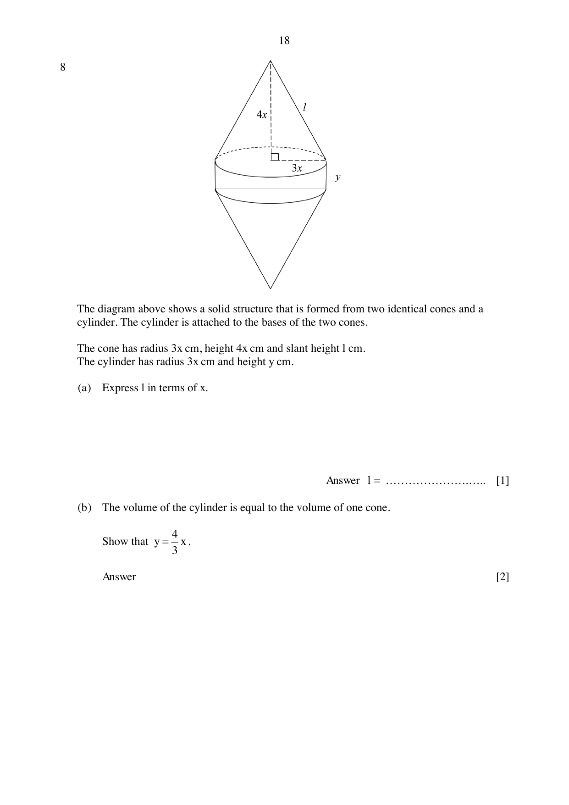

## Question

> **Marks:** 9
> **Page:** 18–19

The diagram shows a solid structure that is formed from two identical cones and a cylinder. The cylinder is attached to the bases of the two cones. The cone has radius $3x$ cm, height $4x$ cm and slant height $l$ cm. The cylinder has radius $3x$ cm and height $y$ cm.

(a) Express $l$ in terms of $x$. [1]

(b) The volume of the cylinder is equal to the volume of one cone. Show that $y = \dfrac{4}{3}x$. [2]

(c) The total surface area of the solid structure is $(200-x)\pi\text{ cm}^{2}$. Write an expression, in terms of $x$, for the total surface area of the solid and show that it reduces to $38x^{2}+x-200 = 0$. [3]

(d) Solve the equation $38x^{2}+x-200 = 0$, giving your solutions correct to 2 decimal places. [3]

## Answer Scheme

(a) $l^{2} = (3x)^{2}+(4x)^{2} = 25x^{2}$, so $l = 5x$. [B1]

(b) $\pi(3x)^{2}y = \dfrac{1}{3}\pi(3x)^{2}(4x)$, so $y = \dfrac{4}{3}x$, shown. [M1, A1]

(c) Two cones: $2\times\pi(3x)(5x) = 30\pi x^{2}$. [M1]

Cylinder: $2\pi(3x)\left(\dfrac{4}{3}x\right) = 8\pi x^{2}$. [M1]

$38\pi x^{2} = (200-x)\pi$, so $38x^{2}+x-200 = 0$, shown. [A1]

(d) $x = \dfrac{-1\pm\sqrt{30401}}{76}$. [M1, M1]

$x = 2.28$ or $x = -2.31$ (not accepted). [A1]
