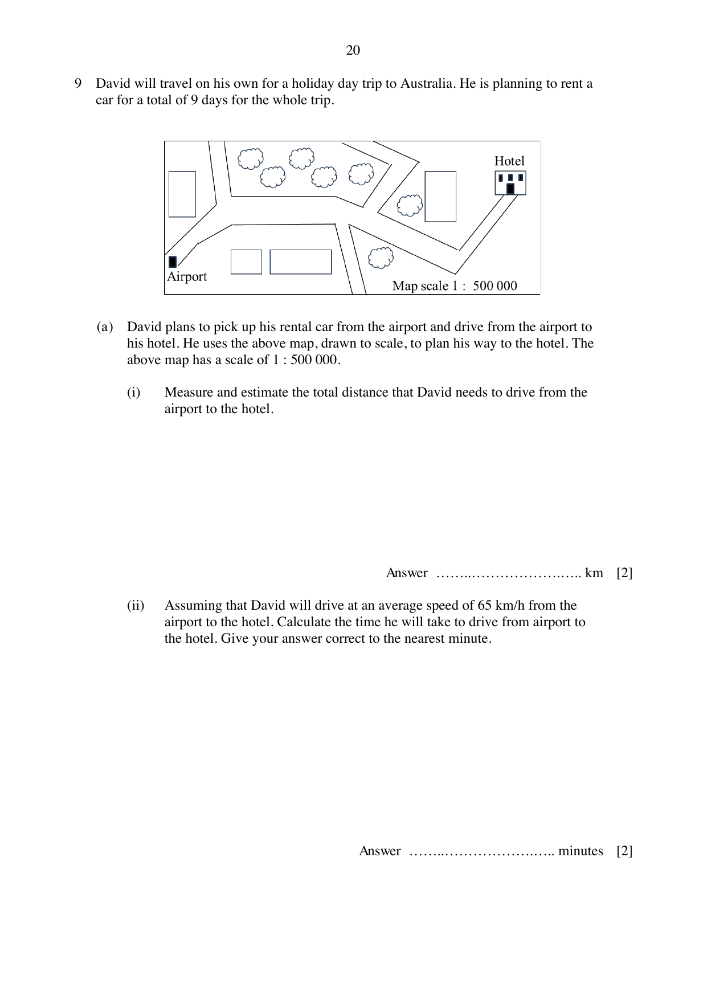
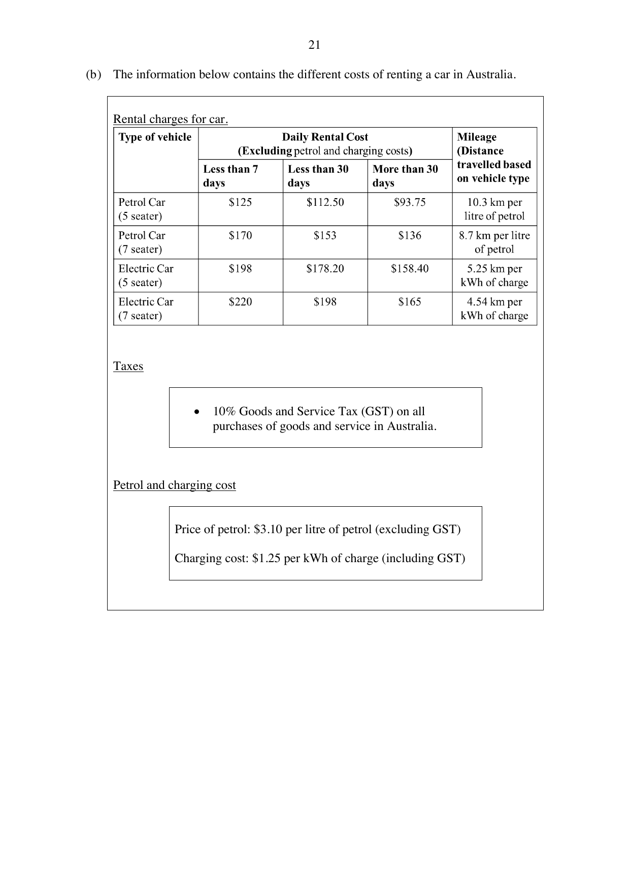

## Question

> **Marks:** 10
> **Page:** 20–22

David will travel on his own for a holiday day trip to Australia. He is planning to rent a car for a total of 9 days for the whole trip.

(a) David plans to pick up his rental car from the airport and drive from the airport to his hotel. He uses the map below, drawn to scale, to plan his way to the hotel. The map has a scale of $1:500000$.

(i) Measure and estimate the total distance that David needs to drive from the airport to the hotel. [2]

(ii) Assuming that David will drive at an average speed of $65$ km/h from the airport to the hotel, calculate the time he will take. Give your answer correct to the nearest minute. [2]

(b) The information below contains the different costs of renting a car in Australia, including rental charges, $10\%$ GST, petrol at ＄3.10 per litre excluding GST, and charging at ＄1.25 per kWh including GST.

David estimates that his total driving distance for the whole trip will be $850$ km, including the journey to and fro from the airport to the hotel. After some calculations, David concludes that renting the electric car (5 seater) is the cheapest option for his whole trip. Do you agree with David? Justify your answer with workings. [6]

## Answer Scheme

(a) (i) Measured distance $11.5$ cm. Accept $11.0$ to $12.5$ cm. Scale $1$ cm : $5$ km, so the actual distance is $55$ km to $62.5$ km. [M1, A1]

(ii) Time is $51$ to $58$ minutes. For example, $\dfrac{55}{65}\times 60 = 50.8$ minutes, which rounds to $51$. [M1, A1]

(b) Electric 5-seater: $9\times 178.20\times 1.10 = 1764.18$. [M1]

Charging: $\dfrac{850}{5.25}\times 1.25 = 202.380$. [M1]

Total electric cost $= 1966.56$. [M1]

Petrol 5-seater: $9\times 112.50\times 1.10 = 1113.75$. [M1]

Petrol: $\dfrac{850}{10.3}\times 3.10\times 1.10 = 281.407$. Total $= 1395.16$. [M1]

David is not correct. The electric car costs more than the petrol car. [A1]
