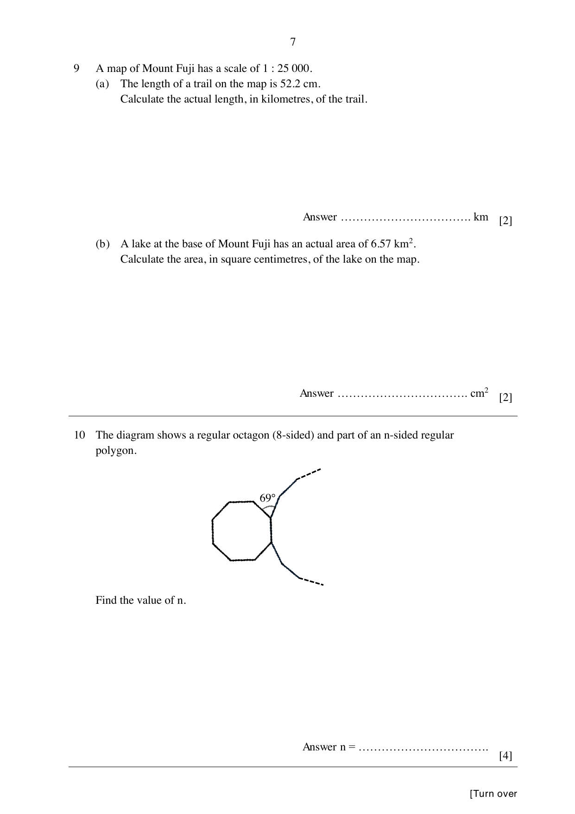

## Question

> **Marks:** 4
> **Page:** 7

The diagram shows a regular octagon (8-sided) and part of an $n$-sided regular polygon. Find the value of $n$. [4]

## Answer Scheme

Each interior angle of the octagon $= \dfrac{(8-2)\times 180^{\circ}}{8} = 135^{\circ}$. [M1]

Interior angle of the $n$-gon $= 360^{\circ}-69^{\circ}-135^{\circ} = 156^{\circ}$. [M1]

Each exterior angle $= 180^{\circ}-156^{\circ} = 24^{\circ}$.

$n = \dfrac{360^{\circ}}{24^{\circ}} = 15$. [M1, A1]

Alternative: $\dfrac{(n-2)\times 180^{\circ}}{n} = 156$, so $n = 15$.
