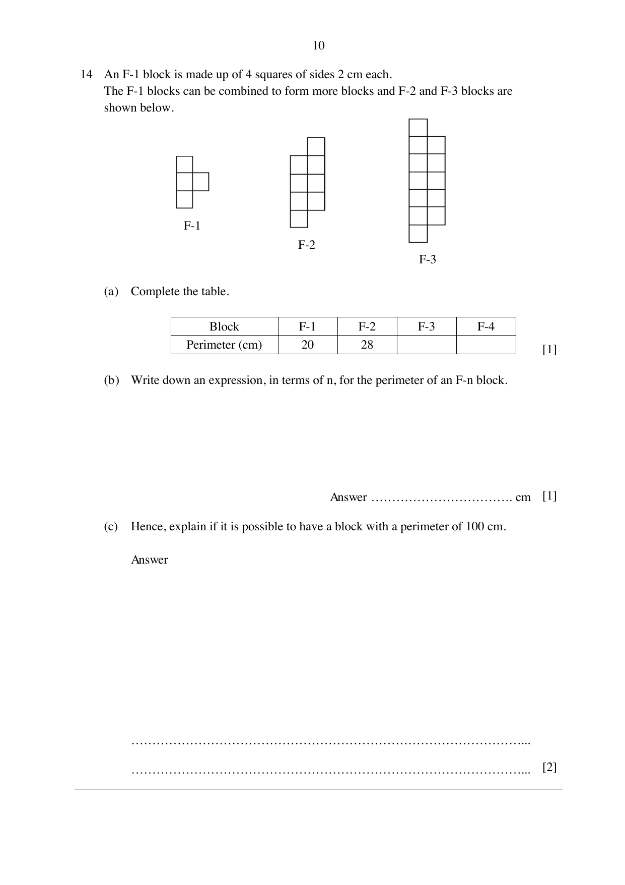

## Question

> **Marks:** 4
> **Page:** 10

An F-1 block is made up of 4 squares of sides $2$ cm each.
The F-1 blocks can be combined to form more blocks and F-2 and F-3 blocks are shown below.

(a) Complete the table. [1]

| Block | F-1 | F-2 | F-3 | F-4 |
| --- | --- | --- | --- | --- |
| Perimeter (cm) | 20 | 28 |  |  |

(b) Write down an expression, in terms of $n$, for the perimeter of an F-$n$ block. [1]

(c) Hence, explain if it is possible to have a block with a perimeter of $100$ cm. [2]

## Answer Scheme

(a) F-3 perimeter $36$ cm, F-4 perimeter $44$ cm. [B1]

(b) $8n+12$ cm [B1]

(c) $8n+12 = 100$, so $8n = 88$ and $n = 11$. [M1]

Since $n$ is an integer, it is possible. It happens in the F-11 block. [A1]
