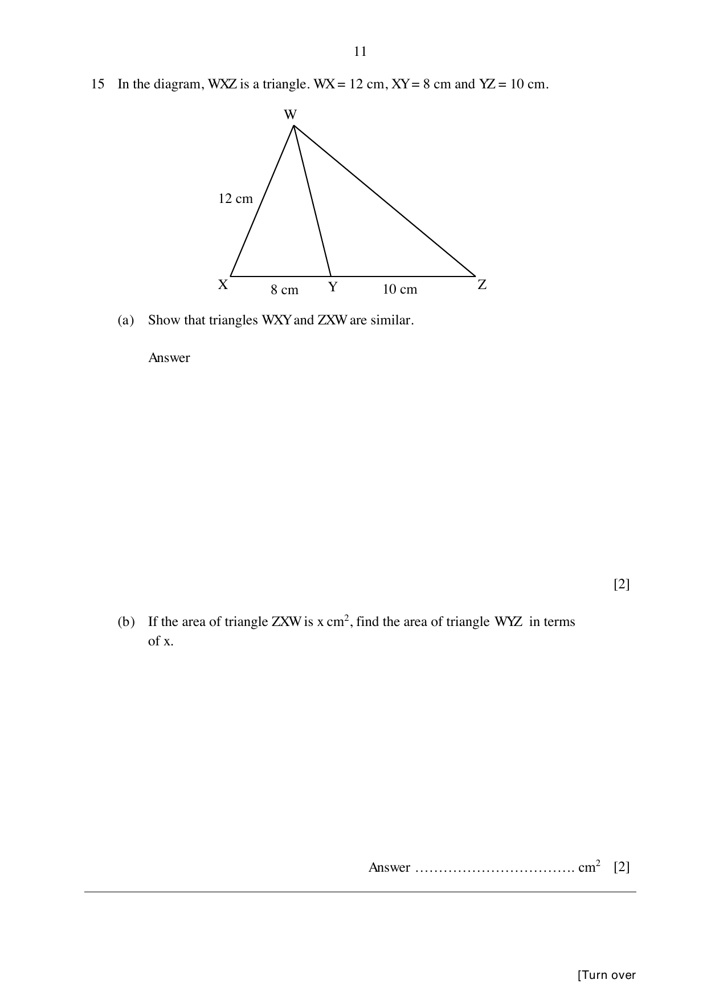

## Question

> **Marks:** 4
> **Page:** 11

In the diagram, $WXZ$ is a triangle. $WX = 12$ cm, $XY = 8$ cm and $YZ = 10$ cm.

(a) Show that triangles $WXY$ and $ZXW$ are similar. [2]

(b) If the area of triangle $ZXW$ is $x\text{ cm}^{2}$, find the area of triangle $WYZ$ in terms of $x$. [2]

## Answer Scheme

(a) $\dfrac{XY}{XW} = \dfrac{8}{12} = \dfrac{2}{3}$ and $\angle WXY = \angle ZXW$ (common angle). $\dfrac{XW}{XZ} = \dfrac{12}{18} = \dfrac{2}{3}$.

Hence triangle $WXY$ is similar to triangle $ZXW$ (SAS similarity). [M1, A1]

(b) $\dfrac{\text{area of }WXY}{x} = \left(\dfrac{2}{3}\right)^{2} = \dfrac{4}{9}$, so area of $WXY = \dfrac{4}{9}x$.

Area of $WYZ = x-\dfrac{4}{9}x = \dfrac{5}{9}x\text{ cm}^{2}$. [M1, A1]
