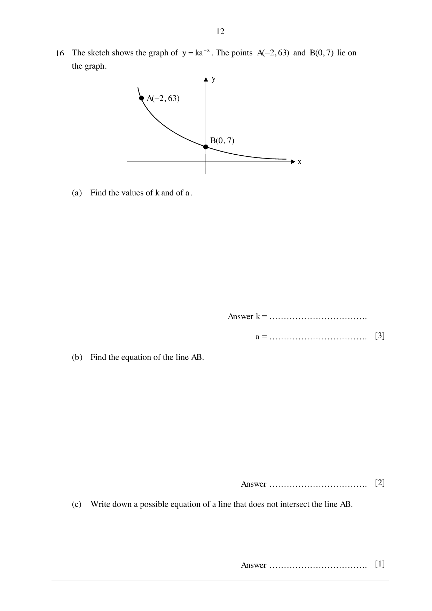

## Question

> **Marks:** 6
> **Page:** 12

The sketch shows the graph of $y = ka^{-x}$. The points $A(-2, 63)$ and $B(0, 7)$ lie on the graph.

(a) Find the values of $k$ and of $a$. [3]

(b) Find the equation of the line $AB$. [2]

(c) Write down a possible equation of a line that does not intersect the line $AB$. [1]

## Answer Scheme

(a) At $B(0,7)$, $7 = ka^{0}$, so $k = 7$. [B1]

$63 = 7a^{-(-2)} = 7a^{2}$, so $a^{2} = 9$ and $a = 3$. [M1, A1]

(b) $m_{AB} = \dfrac{63-7}{-2-0} = -28$, so $y = -28x+7$. [M1, A1]

(c) $y = -28x+k$, where $k\in\mathbb{R}$ and $k\neq 7$. Or $y = -28x+1$. [B1]
