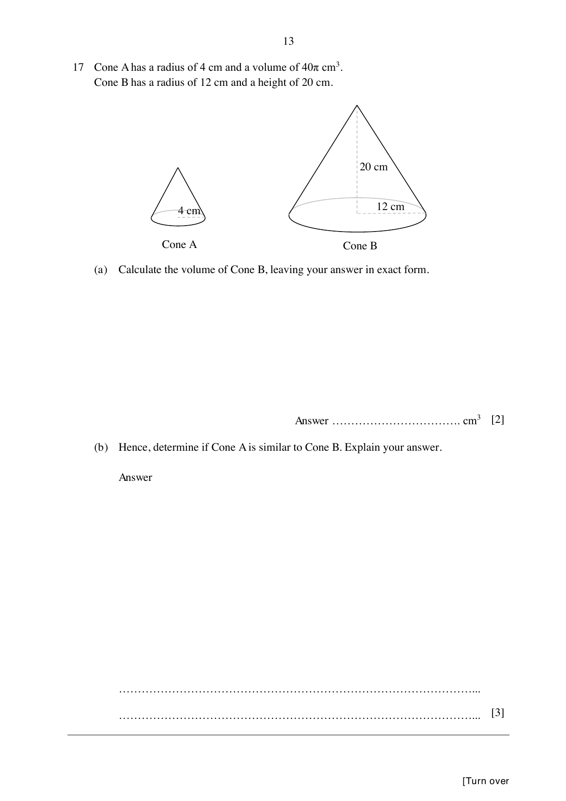

## Question

> **Marks:** 5
> **Page:** 13

Cone A has a radius of $4$ cm and a volume of $40\pi\text{ cm}^{3}$.
Cone B has a radius of $12$ cm and a height of $20$ cm.

(a) Calculate the volume of Cone B, leaving your answer in exact form. [2]

(b) Hence, determine if Cone A is similar to Cone B. Explain your answer. [3]

## Answer Scheme

(a) Volume of Cone B $= \dfrac{1}{3}\pi(12)^{2}(20) = 960\pi\text{ cm}^{3}$. [M1, A1]

(b) From Cone A, $\dfrac{1}{3}\pi(4)^{2}h = 40\pi$, so $h = 7.5$. [M1]

$\dfrac{r_{A}}{r_{B}} = \dfrac{4}{12} = \dfrac{1}{3}$ but $\dfrac{h_{A}}{h_{B}} = \dfrac{7.5}{20} = \dfrac{3}{8}$. Since the ratios are not equal, Cone A is not similar to Cone B. [M1, A1]

Alternative: $\left(\dfrac{r_{A}}{r_{B}}\right)^{3} = \dfrac{1}{27}$ but $\dfrac{V_{A}}{V_{B}} = \dfrac{40\pi}{960\pi} = \dfrac{1}{24}$. Since $\dfrac{V_{A}}{V_{B}}\neq\left(\dfrac{r_{A}}{r_{B}}\right)^{3}$, the cones are not similar.
