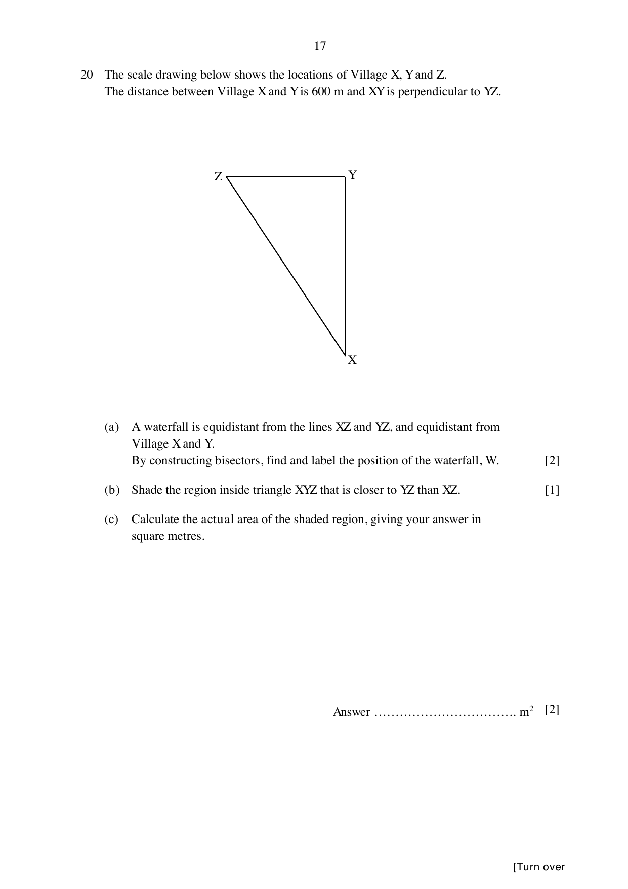

## Question

> **Marks:** 5
> **Page:** 17

The scale drawing below shows the locations of Village $X$, $Y$ and $Z$.
The distance between Village $X$ and $Y$ is $600$ m and $XY$ is perpendicular to $YZ$.

(a) A waterfall is equidistant from the lines $XZ$ and $YZ$, and equidistant from Village $X$ and $Y$. By constructing bisectors, find and label the position of the waterfall, $W$. [2]

(b) Shade the region inside triangle $XYZ$ that is closer to $YZ$ than $XZ$. [1]

(c) Calculate the actual area of the shaded region, giving your answer in square metres. [2]

## Answer Scheme

(a) Angle bisector of $\angle XZY$ and the perpendicular bisector of $XY$ meet at $W$. [B1 each construction]

(b) Shade the region on the $YZ$ side of the angle bisector, inside the triangle. [B1]

(c) Measured $6$ cm represents $600$ m, so $1$ cm represents $100$ m. Measured legs about $2.2$ cm and $4$ cm ($\pm 0.1$).

Actual area $= \dfrac{1}{2}\times 220\times 400 = 44000\text{ m}^{2}$. [M1, A1]

Accept $40950$, $42000$, $42900$, $43050$, $44000$, $44850$, $45100$, $46000$, $46150$.

