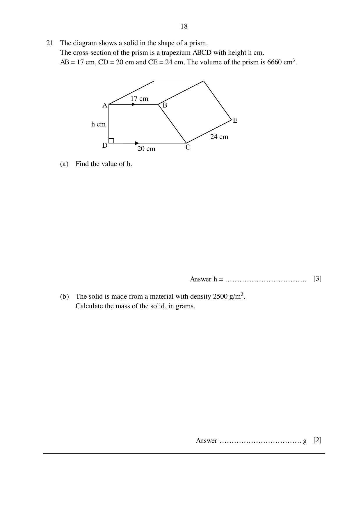

## Question

> **Marks:** 5
> **Page:** 18

The diagram shows a solid in the shape of a prism.
The cross-section of the prism is a trapezium $ABCD$ with height $h$ cm.
$AB = 17$ cm, $CD = 20$ cm and $CE = 24$ cm. The volume of the prism is $6660\text{ cm}^{3}$.

(a) Find the value of $h$. [3]

(b) The solid is made from a material with density $2500\text{ g/m}^{3}$. Calculate the mass of the solid, in grams. [2]

## Answer Scheme

(a) Area of trapezium $= \dfrac{1}{2}(17+20)h = 18.5h$. [M1]

$18.5h\times 24 = 6660$, so $h = 15$. [M1, A1]

(b) $6660\text{ cm}^{3} = 0.00666\text{ m}^{3}$. Mass $= 2500\times 0.00666 = 16.65$ g, or $16\dfrac{13}{20}$ g. [M1, A1]
