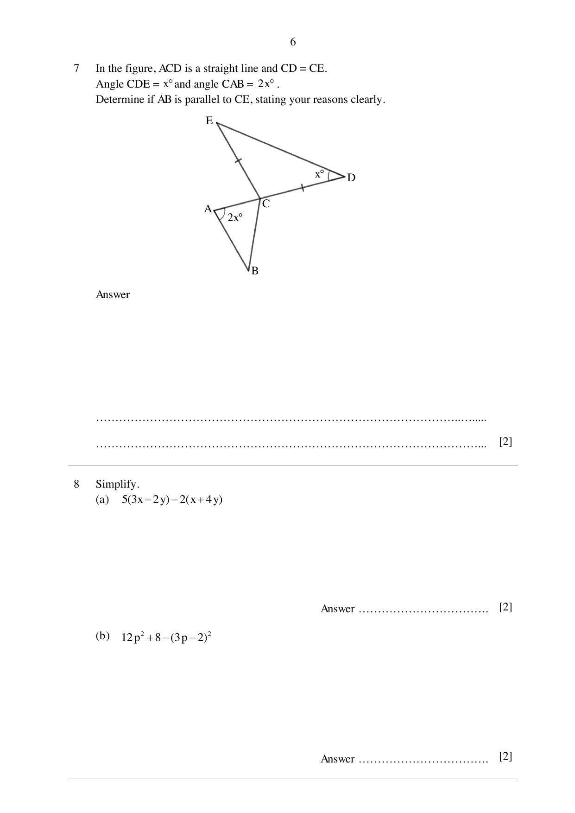

## Question

> **Marks:** 2
> **Page:** 6

In the figure, $ACD$ is a straight line and $CD = CE$.
Angle $CDE = x^{\circ}$ and angle $CAB = 2x^{\circ}$.
Determine if $AB$ is parallel to $CE$, stating your reasons clearly. [2]

## Answer Scheme

$\angle CED = x^{\circ}$ (base angles of an isosceles triangle).

$\angle ECA = 2x^{\circ}$ (exterior angle of a triangle). [M1]

Since $\angle ECA = \angle CAB = 2x^{\circ}$, by alternate angles and parallel lines, $AB\parallel CE$. [A1]

Minus 1 mark from this question if reasons are wrong or missing.
