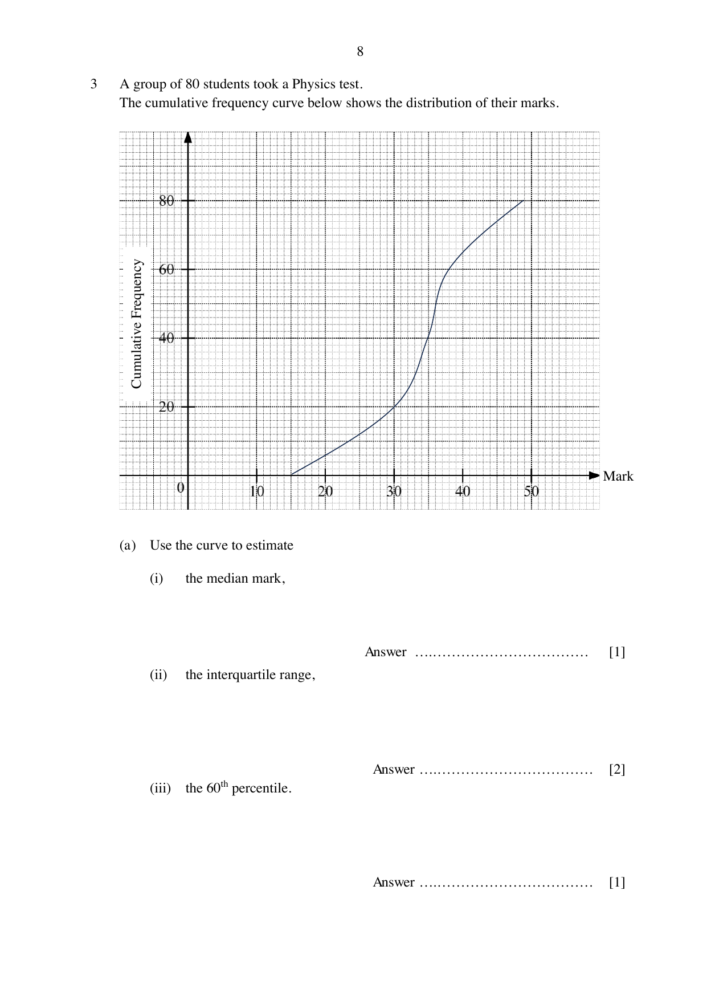
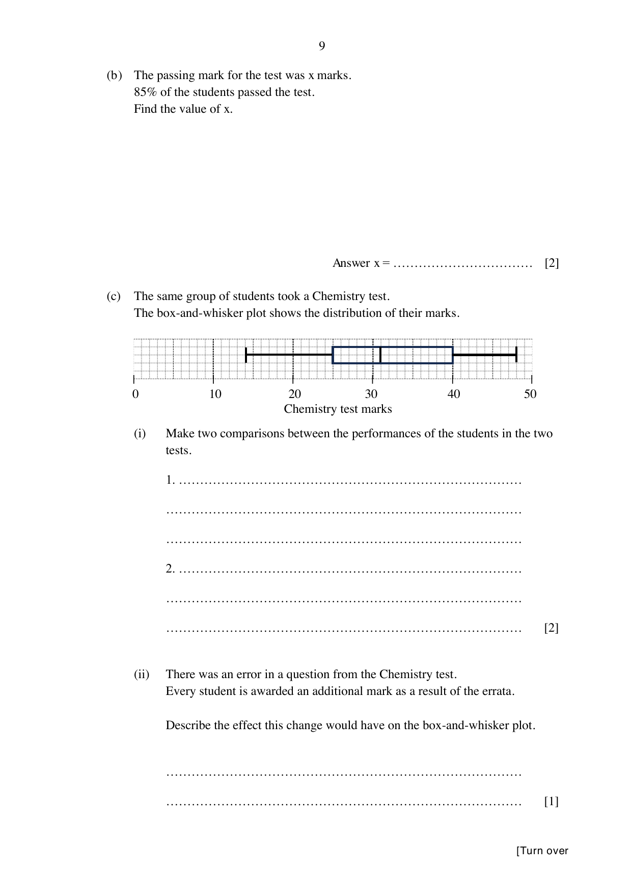

## Question

> **Marks:** 9
> **Page:** 8–9

A group of 80 students took a Physics test. The cumulative frequency curve below shows the distribution of their marks.

(a) Use the curve to estimate

(i) the median mark, [1]

(ii) the interquartile range, [2]

(iii) the 60th percentile. [1]

(b) The passing mark for the test was $x$ marks. $85\%$ of the students passed the test. Find the value of $x$. [2]

(c) The same group of students took a Chemistry test. The box-and-whisker plot shows the distribution of their marks.

(i) Make two comparisons between the performances of the students in the two tests. [2]

(ii) There was an error in a question from the Chemistry test. Every student is awarded an additional mark as a result of the errata. Describe the effect this change would have on the box-and-whisker plot. [1]

## Answer Scheme

(a) (i) Median mark $= 35$. [B1]

(ii) $38-30 = 8$. [M1, A1]

(iii) $\dfrac{60}{100}\times 80 = 48$. From the graph, the 60th percentile is $36$. [B1]

(b) $\dfrac{85}{100}\times 80 = 68$, so $12$ students scored less than $x$. From the graph, $x = 25$. [M1, A1]

(c) (i) Chemistry median $32$, IQR $40-25 = 15$. Physics median $35$, IQR $8$.

Students perform better in Physics because the median is $35$, compared with $32$ for Chemistry. [B1]

The Physics marks are more consistent because the interquartile range is $8$, compared with $15$ for Chemistry. [B1]

Values of the median or IQR must be used.

(ii) The entire box-and-whisker plot shifts to the right by one mark. [B1]
