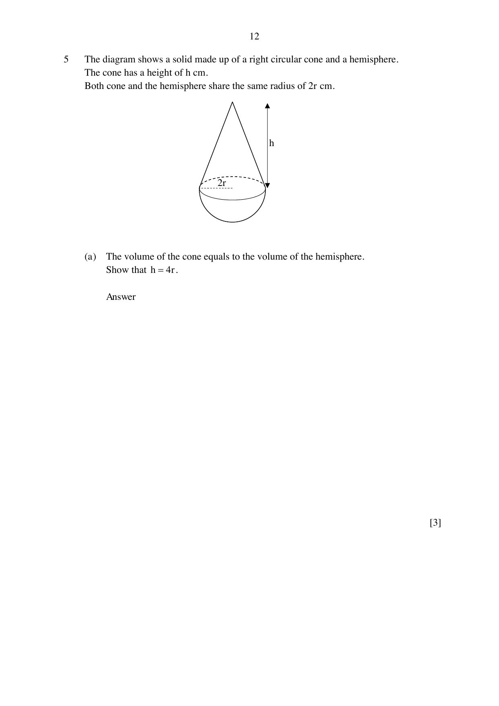

## Question

> **Marks:** 8
> **Page:** 12–13

The diagram shows a solid made up of a right circular cone and a hemisphere. The cone has a height of $h$ cm. Both the cone and the hemisphere share the same radius of $2r$ cm.

(a) The volume of the cone equals the volume of the hemisphere. Show that $h = 4r$. [3]

(b) The volume of the hemisphere is $450\text{ cm}^{3}$. Find the total surface area of the solid. [5]

## Answer Scheme

(a) $\dfrac{2}{3}\pi(2r)^{3} = \dfrac{1}{3}\pi(2r)^{2}h$ [M1 hemisphere, M1 cone]

$\dfrac{16}{3}\pi r^{3} = \dfrac{4}{3}\pi r^{2}h$

$h = 4r$ [A1]

(b) $\dfrac{2}{3}\pi(2r)^{3} = 450$, so $r = 2.9947$ (5 s.f.). [M1, A1]

$l = \sqrt{(2r)^{2}+(4r)^{2}} = 13.392$. [M1]

Total surface area $= 2\pi(2\times 2.9947)^{2}+\pi(2\times 2.9947)(13.392) = 477\text{ cm}^{2}$ (3 s.f.). [M1, A1]
