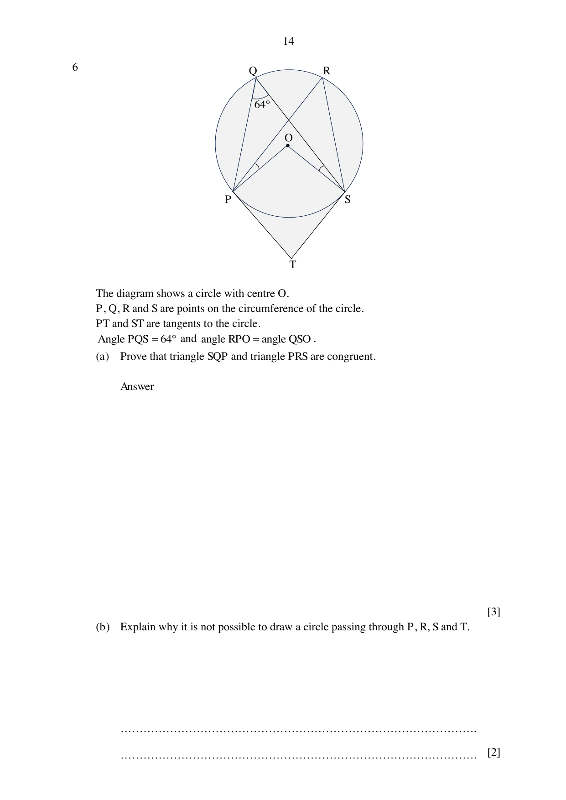

## Question

> **Marks:** 11
> **Page:** 14–15

The diagram shows a circle with centre $O$. $P$, $Q$, $R$ and $S$ are points on the circumference of the circle. $PT$ and $ST$ are tangents to the circle. Angle $PQS = 64^{\circ}$ and angle $RPO =$ angle $QSO$.

(a) Prove that triangle $SQP$ and triangle $PRS$ are congruent. [3]

(b) Explain why it is not possible to draw a circle passing through $P$, $R$, $S$ and $T$. [2]

(c) (i) Given that $PS = 13.5$ cm, show that the radius of the circle is $7.51$ cm, correct to 3 significant figures. [2]

(ii) Hence, find the area of the shaded figure. [4]

## Answer Scheme

(a) $\angle PQS = \angle SRP$ (angles in the same segment).

$\angle OSP = \angle OPS$ (base angles of an isosceles triangle).

$\angle QSP = \angle QSO+\angle OSP = \angle RPO+\angle OPS = \angle RPS$.

$PS$ is common. By AAS, triangles $SQP$ and $PRS$ are congruent. [M1 any two reasons, M2 all three, A1]

A maximum of 1 mark is deducted from this question for any wrong reason.

(b) $\angle POS = 64^{\circ}\times 2 = 128^{\circ}$ (angle at the centre).

$\angle OPT = \angle OST = 90^{\circ}$ (tangent perpendicular to radius).

$\angle PTS = 360^{\circ}-90^{\circ}-90^{\circ}-128^{\circ} = 52^{\circ}$. [M1]

$\angle PTS+\angle PRS = 52^{\circ}+64^{\circ} = 116^{\circ}\neq 180^{\circ}$. By the opposite-segment property, a circle cannot pass through $P$, $R$, $S$ and $T$. [A1]

(c) (i) $\angle OPS = \dfrac{180^{\circ}-128^{\circ}}{2} = 26^{\circ}$.

$\dfrac{r}{\sin 26^{\circ}} = \dfrac{13.5}{\sin 128^{\circ}}$, so $r = 7.5100 = 7.51$ cm (3 s.f.), shown. [M1, A1]

Alternative cosine rule: $13.5^{2} = 2r^{2}-2r^{2}\cos 128^{\circ}$.

(ii) $PT = 7.5100\tan 64^{\circ} = 15.397$. [M1]

Area of kite $OPTS = \dfrac{1}{2}\times 15.397\times 7.5100\times 2 = 115.63\text{ cm}^{2}$. [M1]

Major sector $= \dfrac{232}{360}\times\pi\times 7.5100^{2} = 114.18\text{ cm}^{2}$. [M1]

Total $= 230\text{ cm}^{2}$ (3 s.f.). [A1]
