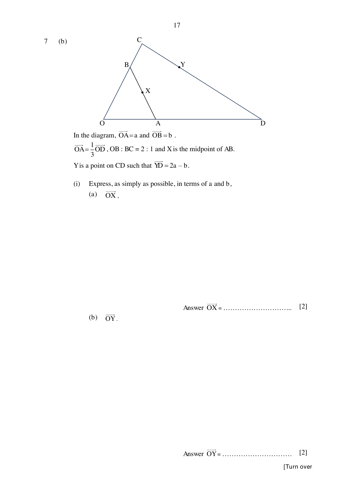

## Question

> **Marks:** 10
> **Page:** 16–18

(a) The points $A$, $B$ and $C$ are vertices of a triangle. The point $A$ is $(-5, 4)$.

$\overrightarrow{AB} = \begin{pmatrix} 3k \\ 4k \end{pmatrix}$, where $k$ is a positive constant.

The equation of $BC$ is $x = 1$, and $C$ lies on the $x$-axis.

Find the area of triangle $ABC$. [4]

(b) In the diagram, $\overrightarrow{OA} = \mathbf{a}$ and $\overrightarrow{OB} = \mathbf{b}$.

$\overrightarrow{OA} = \dfrac{1}{3}\overrightarrow{OD}$, $OB:BC = 2:1$ and $X$ is the midpoint of $AB$.

$Y$ is a point on $CD$ such that $\overrightarrow{YD} = 2\mathbf{a}-\mathbf{b}$.

(i) Express, as simply as possible, in terms of $\mathbf{a}$ and $\mathbf{b}$,

(a) $\overrightarrow{OX}$, [2]

(b) $\overrightarrow{OY}$. [2]

(ii) Write down two facts about $O$, $X$ and $Y$. [2]

## Answer Scheme

(a) $-5+3k = 1$, so $k = 2$ and $B$ is $(1, 12)$. [M1, M1]

$C$ is $(1, 0)$. Area $= \dfrac{1}{2}\times 6\times 12 = 36$ units$^{2}$. [M1, A1]

(b) (i) (a) $\overrightarrow{OX} = \dfrac{1}{2}\mathbf{a}+\dfrac{1}{2}\mathbf{b}$. [M1, A1]

(b) $\overrightarrow{OD} = 3\mathbf{a}$. [M1]

$\overrightarrow{OY} = 3\mathbf{a}-(2\mathbf{a}-\mathbf{b}) = \mathbf{a}+\mathbf{b}$. [A1]

(ii) $O$, $X$ and $Y$ are collinear. $\overrightarrow{OX} = \dfrac{1}{2}\overrightarrow{OY}$, or $X$ is the midpoint of $OY$. [B1, B1]

Both parts of (b)(i) must be correct before these marks are awarded.
