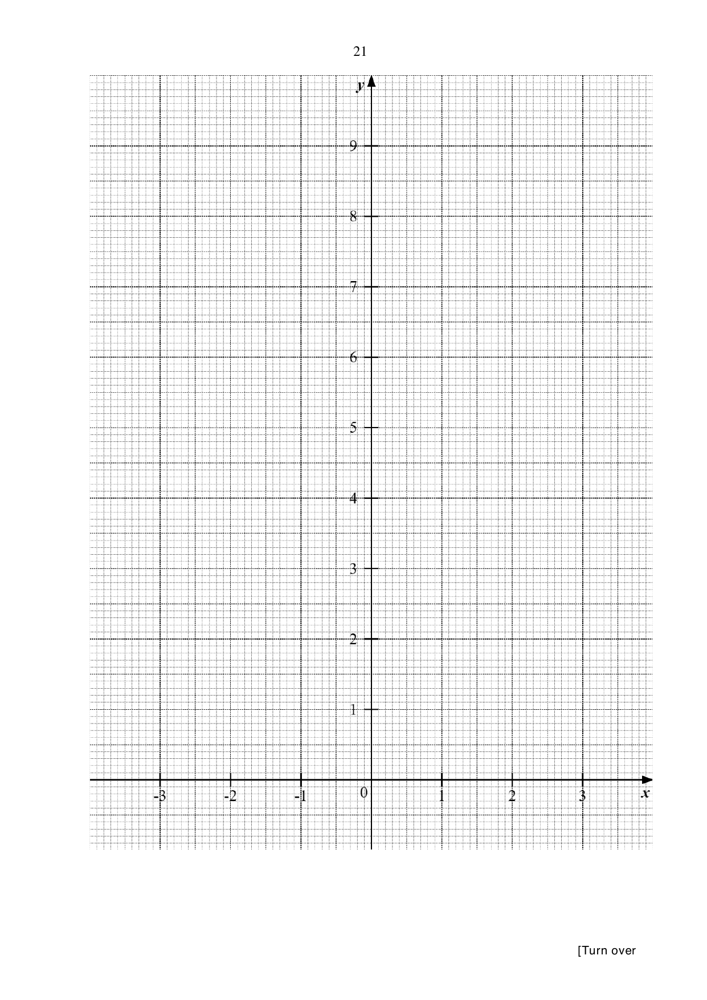

## Question

> **Marks:** 11
> **Page:** 20–21

(a) Complete the table of values for $y = \dfrac{2}{x^{2}}+\dfrac{x^{2}}{2}-1$. Values are given to one decimal place where appropriate. [1]

| $x$ | $-3$ | $-2$ | $-1.5$ | $-1$ | $-0.5$ | $0.5$ | $1$ | $1.5$ | $2$ | $3$ |
| --- | --- | --- | --- | --- | --- | --- | --- | --- | --- | --- |
| $y$ | 3.7 | 1.5 | 1.0 |  | 7.1 | 7.1 |  | 1.0 | 1.5 | 3.7 |

(b) On the grid opposite, draw the graph of $y = \dfrac{2}{x^{2}}+\dfrac{x^{2}}{2}-1$ for $-3\le x\le 3$. [3]

(c) By drawing a tangent, find the gradient of the curve at the point $(2, 1.5)$. [2]

(d) The equation $\dfrac{2}{x^{2}}+\dfrac{x^{2}}{2}-1 = k$ has two solutions. Use your graph to estimate the value of $k$. [1]

(e) By drawing a suitable straight line on the grid, solve the equation $x^{4}+x^{3}-4x^{2}+4 = 0$. [4]

## Answer Scheme

(a) Missing values: when $x = -1$, $y = 1.5$; when $x = 1$, $y = 1.5$. [B1 both]

(b) Correct points [B1]. Smooth curve on one side [B1]. Smooth curves on both sides, not joined across the asymptote [B1].

(c) Tangent at $(2, 1.5)$. Example gradient $\dfrac{3-0}{3-1} = 1.5$. Accept $1.3$ to $1.7$. [M1, A1]

(d) $k = 0.9$, $0.95$ or $1$. [B1]

(e) Dividing $x^{4}+x^{3}-4x^{2}+4 = 0$ by $2x^{2}$ gives $\dfrac{2}{x^{2}}+\dfrac{x^{2}}{2}-1 = -\dfrac{1}{2}x+1$. [M1]

Draw $y = -\dfrac{1}{2}x+1$. [M1]

$x = -1.1$, $-1.05$, $-1$, $-0.95$ or $-0.9$ [A1]

and $x = -2.3$, $-2.35$, $-2.4$, $-2.45$ or $-2.5$. [A1]
