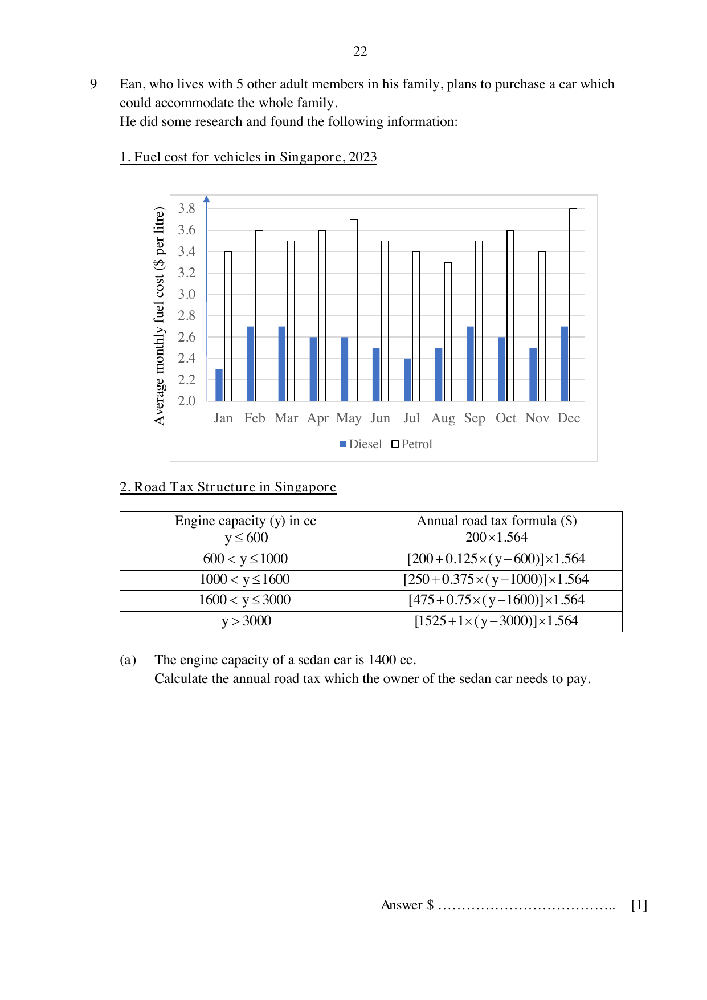

## Question

> **Marks:** 10
> **Page:** 22–24

Ean, who lives with 5 other adult members in his family, plans to purchase a car which could accommodate the whole family. He did some research and found the following information.

1. Fuel cost for vehicles in Singapore, 2023.

2. Road tax structure in Singapore.

| Engine capacity ($y$) in cc | Annual road tax formula (＄) |
| --- | --- |
| $y\le 600$ | $200\times 1.564$ |
| $600 < y\le 1000$ | $[200+0.125\times(y-600)]\times 1.564$ |
| $1000 < y\le 1600$ | $[250+0.375\times(y-1000)]\times 1.564$ |
| $1600 < y\le 3000$ | $[475+0.75\times(y-1600)]\times 1.564$ |
| $y > 3000$ | $[1525+1\times(y-3000)]\times 1.564$ |

(a) The engine capacity of a sedan car is $1400$ cc. Calculate the annual road tax which the owner of the sedan car needs to pay. [1]

(b) Estimate the mean monthly cost of diesel over the 12-month period in 2023. [2]

(c) Ean visited a car dealer who shortlisted three models for him.

| Vehicle model | Toyoyo Joah | Ponda Jezel | Ponda Fleet |
| --- | --- | --- | --- |
| Engine capacity (in cc) | 2000 | 1500 | 1500 |
| Vehicle type | Diesel car | Hybrid | Hybrid |
| Fuel type | Diesel | Petrol | Petrol |
| Fuel consumption rate | 16 km per litre | 25 km per litre | 25 km per litre |
| Seating capacity | 7 | 5 | 7 |
| Price | ＄160 000 | ＄140 000 | ＄172 000 |

In partnership with a finance company, the car dealer is offering Ean a loan package which he plans to take up.

| Downpayment for car | ＄0 |
| --- | --- |
| Simple interest rate | $4\%$ per annum |
| Loan period | 7 years |

Ean estimates that he would drive about $11\,000$ km per year. He also plans to keep the car for only 7 years.

Suggest the vehicle model he should purchase. Justify your decision and show your calculations clearly. [7]

## Answer Scheme

(a) $[250+0.375\times(1400-1000)]\times 1.564 = 625.60$. Answer ＄625.60. [B1]

(b) Mean of the twelve monthly diesel readings, including $2.3$, $2.7$, $2.7$, $\ldots$, $2.5$, $2.7$, is ＄2.57 (2 d.p.). [M1, A1]

(c) Compare only cars that seat the whole family (Toyoyo Joah and Ponda Fleet). Be consistent: mean fuel with mean fuel, or dearest fuel with dearest fuel. Ponda Jezel seats only 5.

Method 1, mean fuel, annual cost. Mean petrol $= 3.525$ dollars per litre. [M1]

Annual fuel: Fleet $3.525\times\dfrac{11000}{25} = 1551$; Joah $2.57\times\dfrac{11000}{16} = 1766.875$. [M1 either]

Road tax: Fleet $684.25$; Joah $1212.10$. [M1 either]

Interest: Fleet $\dfrac{4}{100}\times 172000\times 7 = 48160$; Joah $\dfrac{4}{100}\times 160000\times 7 = 44800$. [M1 either]

Annual cost: Fleet $33686.68$; Joah $32236.12$. [A1 each]

Ean should buy the Toyoyo Joah. It seats the family and the annual cost ＄32 236.12 is lower than the Ponda Fleet at ＄33 686.68. [A1]

Method 2 uses the same rates over 7 years: Fleet ＄235 806.75 and Joah ＄225 652.83.

Method 3 uses the dearest fuel, ＄3.80 per litre of petrol and ＄2.70 per litre of diesel. Annual cost: Fleet ＄33 807.68 and Joah ＄32 325.49.

Method 4 over 7 years at those dearest prices: Fleet ＄236 653.75 and Joah ＄226 278.45.

In every accepted method the Toyoyo Joah is cheaper.
