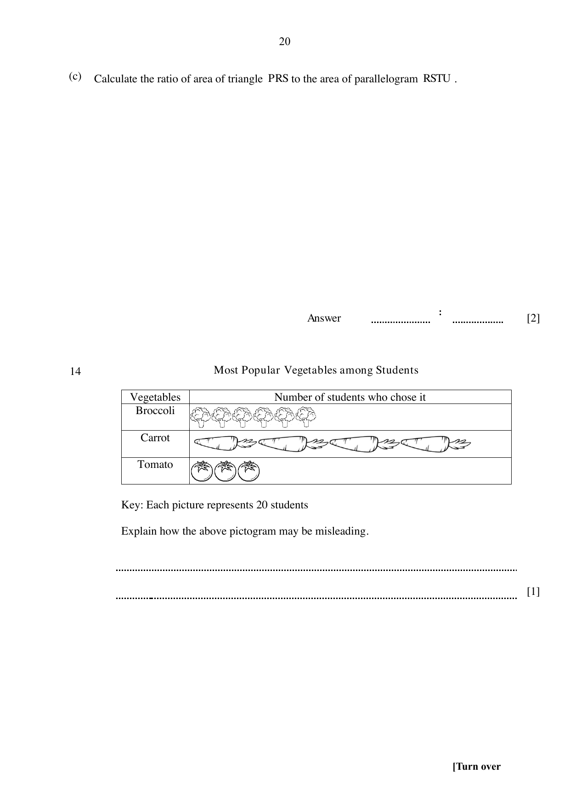

## Question

> **Marks:** 1
> **Page:** 20

Most popular vegetables among students. The pictogram uses pictures of different sizes. Each picture represents 20 students. Explain how the pictogram may be misleading. [1]

