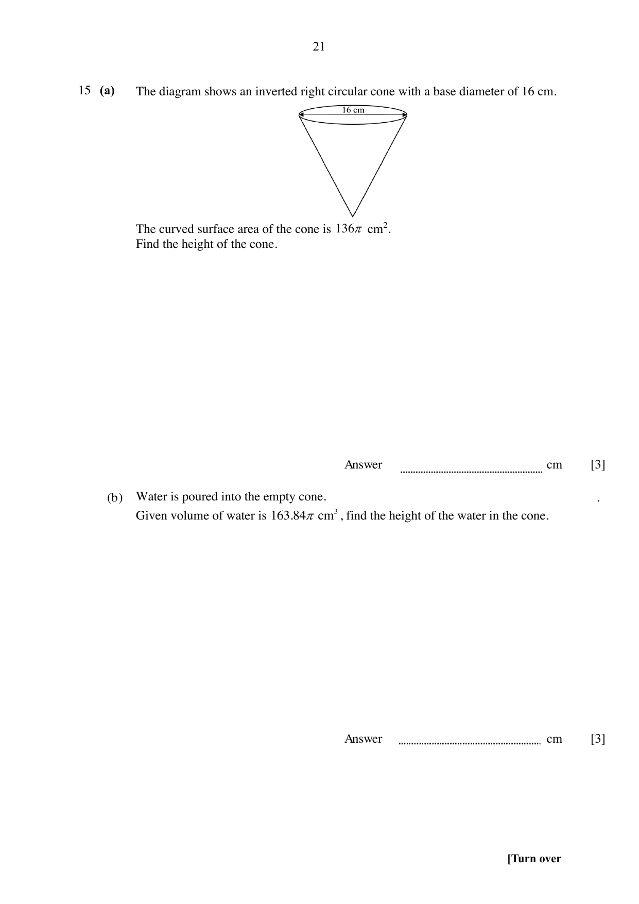

## Question

> **Marks:** 6
> **Page:** 21

(a) The diagram shows an inverted right circular cone with a base diameter of $16$ cm. The curved surface area of the cone is $136\pi\text{ cm}^{2}$. Find the height of the cone. [3]

(b) Water is poured into the empty cone. Given that the volume of water is $163.84\pi\text{ cm}^{3}$, find the height of the water in the cone. [3]
