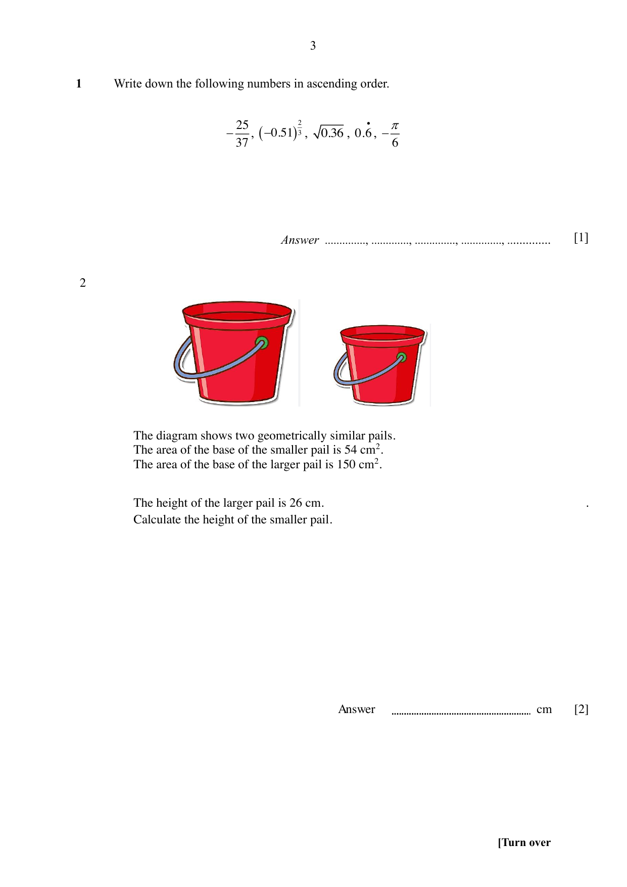

## Question

> **Marks:** 2
> **Page:** 3

The diagram shows two geometrically similar pails. The area of the base of the smaller pail is $54\text{ cm}^{2}$. The area of the base of the larger pail is $150\text{ cm}^{2}$. The height of the larger pail is $26$ cm. Calculate the height of the smaller pail. [2]

