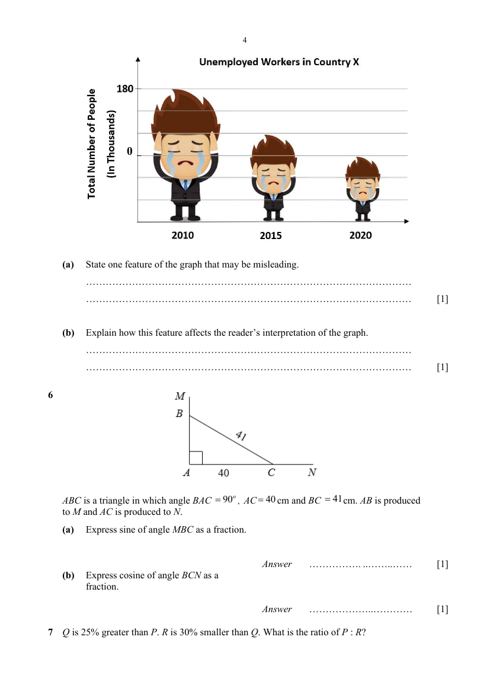

## Question

> **Marks:** (a) [1]; (b) [1]; total [2]
> **Page:** 3–4

The graph shows the number of unemployed workers in Country X for the last 10 years.

**(a)** State one feature of the graph that may be misleading. [1]

**(b)** Explain how this feature affects the reader’s interpretation of the graph. [1]

## Answer Scheme

**(a)** The size of the worker symbol distorts the graph. (Only accept this answer) [A1]

**(b)** The area is not proportional to the actual decrease in unemployed workers. The number of unemployed workers in 2020 is half of that in 2010. However, the size of worker symbol is less than half the size of worker symbol for 2010.

Or: It exaggerates the differences between the number of unemployed workers. [A1]
