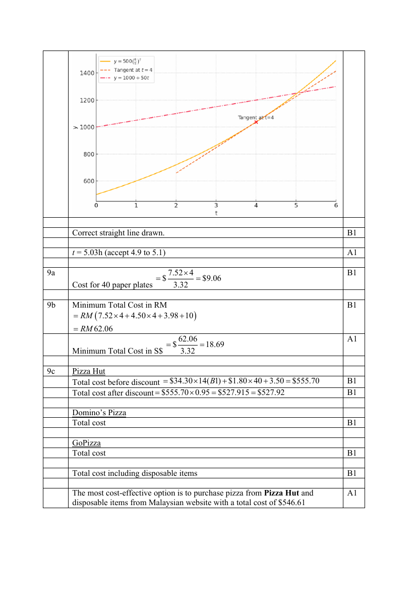

## Question

> **Marks:** (a) [1]; (b) [3]; (c) [2]; (d) [3]; (e) [4]; total [13]
> **Page:** 14–16

A number of bacteria are introduced to a culture. The number of bacteria, $y$, in the culture $t$ hours after they are introduced, is given by the formula $y = 500\left(\dfrac{6}{5}\right)^{t}$. Some corresponding values of $y$ and $t$ are given in the table below.

| Time ($t$ hours) | 0 | 1 | 2 | 3 | 4 | 5 | 6 |
| --- | --- | --- | --- | --- | --- | --- | --- |
| Number of bacteria ($y$) | $p$ | 600 | 720 | 864 | 1037 | 1244 | 1493 |

**(a)** Find the value of $p$. [1]

**(b)** On the grid, draw the graph of $y = 500\left(\dfrac{6}{5}\right)^{t}$ for $0 \leq t \leq 6$. [3]

**(c)** Using your graph, find

**(i)** the number of bacteria in the culture 3.5 hours after they are first introduced, [1]

**(ii)** the minimum number of hours it takes for the number of bacteria to grow to more than 1250. [1]

**(d)** **(i)** By drawing a tangent, find the gradient of the curve when $t = 4$ hours. [2]

**(ii)** Explain briefly what the gradient represents. [1]

**(e)** A second batch of bacteria is introduced to the same culture. The number of bacteria in the second batch, $y$, is not dependent on the first batch, is given by a suitable straight line to be drawn on the same axes. The two batches of bacteria have an equal number of bacteria at the time, $t$.

By drawing a suitable straight line on the grid, solve $t-10\left(\dfrac{6}{5}\right)^{t}+20 = 0$. [4]

## Answer Scheme

**(a)** $p = 500$ [A1]

**(b)** All points plotted correctly [B2], or 4 points plotted correctly [B1]. Smooth curve [B1].

**(c)(i)** 946 (accept 940–960) [A1]

**(ii)** 5.03 h (accept 4.9 to 5.1) [A1]

**(d)(i)** Correct tangent [B1]. Gradient is 189 [A1].

**(ii)** The gradient represents the rate of bacteria growth after 4 hours. [A1]

**(e)** From $y = 500\left(\dfrac{6}{5}\right)^{t}$ and $t-10\left(\dfrac{6}{5}\right)^{t}+20 = 0$,

$$
y = 50t+1000 \quad \text{[M1][B1]}
$$

Correct straight line drawn. [B1]

$t = 5.03$ h (accept 4.9 to 5.1) [A1]
