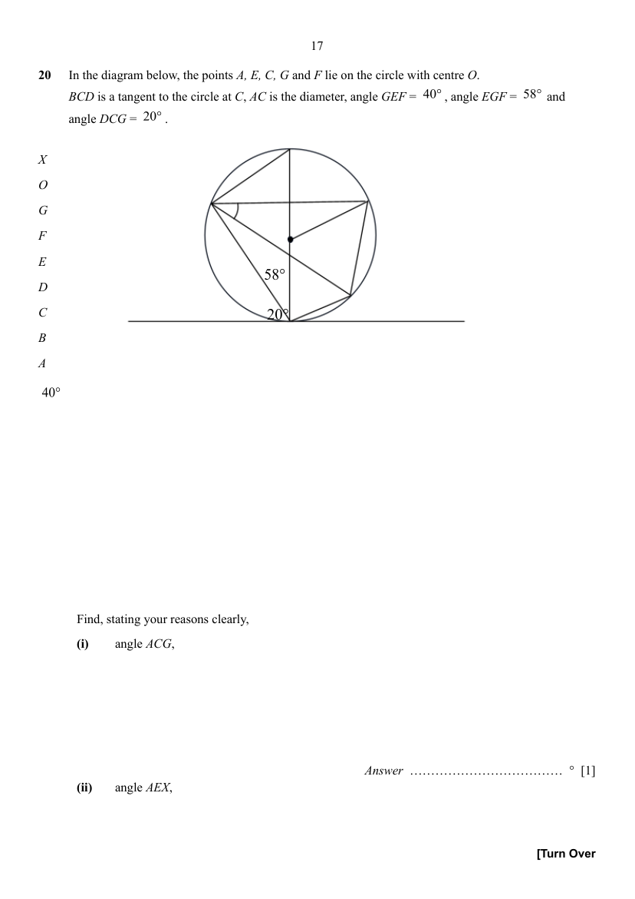

## Question

> **Marks:** (i) 1, (ii) 1, (iii) 1, (iv) 2; total 5
> **Page:** 17–18

In the diagram below, the points $A$, $E$, $C$, $G$ and $F$ lie on the circle with centre $O$. $BCD$ is a tangent to the circle at $C$, $AC$ is the diameter, angle $GEF=40^{\circ}$, angle $EGF=58^{\circ}$ and angle $DCG=20^{\circ}$.

Find, stating your reasons clearly,

**(i)** angle $ACG$, [1]

**(ii)** angle $AEX$, [1]

**(iii)** angle $FOA$, [1]

**(iv)** angle $GCE$. [2]

## Answer Scheme

**(i)** angle $ACG$,

$$
\begin{aligned}
\angle ACD&=90^{\circ}\quad(\text{tan }\perp\text{ rad})\\
\angle ACG&=90^{\circ}-20^{\circ}=70^{\circ}
\end{aligned}
$$

**B1**

**(ii)** angle $AEX$,

$$
\begin{aligned}
\angle AEG&=\angle ACG\quad(\angle\text{ in same segment})\\
\angle AEX&=70^{\circ}-40^{\circ}=30^{\circ}
\end{aligned}
$$

**B1**

**(iii)** angle $FOA$,

$$
\angle FOA=2\times\angle AEX=60^{\circ}\quad(\angle\text{ at centre }=2\times\angle\text{ at circumference})
$$

**B1**

**(iv)** angle $GCE$.

$$
\begin{aligned}
\angle GFE&=180^{\circ}-40^{\circ}-58^{\circ}=82^{\circ}\quad(\angle\text{ sum of }\triangle)\\
\angle GCE&=180^{\circ}-82^{\circ}=98^{\circ}\quad(\angle\text{ in opposite segment})
\end{aligned}
$$

**M1** **A1**
