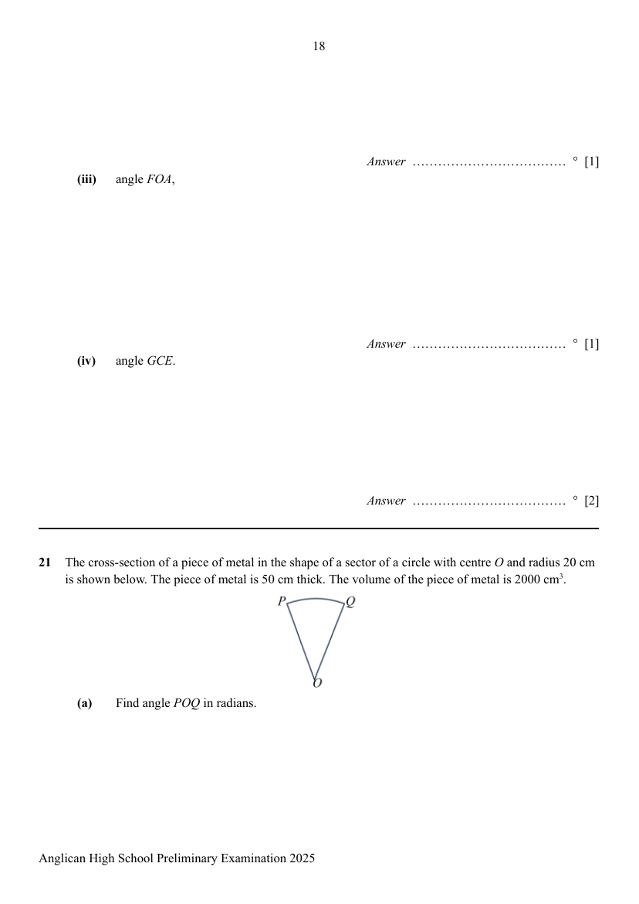

## Question

> **Marks:** (a) 2, (b) 2; total 4
> **Page:** 18–19

The cross-section of a piece of metal in the shape of a sector of a circle with centre $O$ and radius $20$ cm is shown below. The piece of metal is $50$ cm thick. The volume of the piece of metal is $2000\ \mathrm{cm}^{3}$.

**(a)** Find angle $POQ$ in radians. [2]

**(b)** The piece of metal is melted and recast into a sphere. Find the radius of this sphere. [2]

## Answer Scheme

**(a)** Find angle $POQ$ in radians.

$$
\begin{aligned}
\dfrac{1}{2}\times 20^{2}\times\angle POQ\times 50&=2000\\
\angle POQ&=\dfrac{2000\times 2}{50\times 20^{2}}=\dfrac{1}{5}
\end{aligned}
$$

**M1** form equation. **A1**

**(b)** The piece of metal is melted and recast into a sphere. Find the radius of this sphere.

$$
\begin{aligned}
\dfrac{4}{3}\pi r^{3}&=2000\\
r^{3}&=\dfrac{2000\times 3}{4\pi}\\
r&=\sqrt[3]{\dfrac{6000}{4\pi}}=7.8159\ \mathrm{cm}\\
r&=7.82\ \mathrm{cm}\ (3\text{ s.f.})
\end{aligned}
$$

**M1** form equation. **A1**
